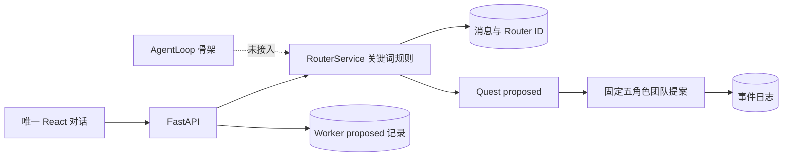

# FORGE Phase 0 工程审计报告

审计日期：2026-11-14（Asia/Shanghai）。结论：**Phase 0 审计工作完成，工程验收存在阻断项，当前不能认定为可自主执行的 Agent 系统，也不能认定为已验证的桌面发布版本。Phase 1 尚未开始。**

## 1. 范围、基线和证据

当前工作分支为 `codex/phase0-audit`，起点为基础配置提交 `38686cf`。实际审计对象是用户提供的 `FORGE_v4_Engineering_Release.zip`，其中包版本为 `0.2.0`。

- ZIP SHA-256：`a2a963c3f69e29f9e5f1de739507620d3ba01e4f939353d09d8b643199d89397`。
- 压缩包共 42 个文件，CRC 检查通过。导入后逐文件比较，除合并保留的 `.gitignore` 外，其余文件与压缩包一致。该比较在添加本审计报告链接前执行。
- 已完整阅读发布包 README、全部 `docs/` 文档和 ADR，以及本地原有 `docs/DEVELOPMENT.md`；已检查全部后端源码、两个测试文件、前端源码、Tauri 和启动脚本。
- **`codex/MASTER_PROMPT.md` 在 ZIP 和当前仓库中均不存在，无法阅读。** README 提到的 threat model、Codex prompts 也没有对应交付文件。没有根据文档中的命令直接进入后续阶段。
- 应用源码未作修复或重构。本阶段新增审计辅助脚本、报告和证据，合并运行产物忽略规则，并保留实际安装生成的 `desktop/package-lock.json`。Python 虚拟环境、数据库和构建产物均未纳入源码。

可复查材料：

- [验证汇总](audit/phase0/verification.json)、[隔离诊断完整结果](audit/phase0/probes.json)、[真实 HTTP 与重启结果](audit/phase0/http-smoke.json)。
- [pytest JUnit 报告](audit/phase0/pytest.xml)、[Python 环境快照](audit/phase0/python-environment.txt)、[前端依赖树](audit/phase0/npm-tree.json)、[npm 完整扫描](audit/phase0/npm-audit.json)、[npm 生产依赖扫描](audit/phase0/npm-audit-production.json)。
- [Ruff 结果](audit/phase0/ruff.json)、[前端与原生构建结果](audit/phase0/build-results.json)。原始命令日志保存在仓库 `.local/phase0/`；证据清单包含日志哈希。

审计辅助脚本的退出码 0 表示诊断完成，**不表示所有被审计条件通过**。故障注入、交错写入和未授权请求都只针对新建的隔离数据库，没有修改用户业务数据，也没有实际调用模型或执行 Worker。

## 2. 当前结构与依赖

| 层 | 当前实现 | 判断 |
| --- | --- | --- |
| Core | `forge_core/domain.py`、`store.py`、`router.py`、`registry.py`、`quest_service.py`、`runtime.py` | 小型基础骨架；有领域类型和 SQLite 存储，没有完整运行时 |
| API | `forge_api/main.py`，10 个业务/健康路径 | FastAPI 同步接口；组合根在模块导入时初始化数据库 |
| 前端 | React 18、TypeScript、Vite 5，单一 `App.tsx` | 单一聊天入口和 Quest 面板已存在；多数导航只是静态元素 |
| 桌面 | Tauri v2 Rust shell、capability manifest | 只创建窗口；没有 Core 进程管理、sidecar、端口协商或健康恢复 |
| 存储 | SQLite WAL、foreign_keys、busy_timeout | 基础读写可用；缺少可靠迁移、完整工作单元和事件消费协议 |
| 测试 | `test_api.py` 1 个、`test_core.py` 7 个 | 全部通过，但关键安全、并发、恢复、真实执行路径未覆盖 |

后端声明的是浮动下界依赖：FastAPI、Uvicorn、Pydantic，以及 pytest/httpx/Ruff 开发依赖；发布包没有 Python 锁文件。实际安装版本包括 FastAPI 0.162.7、Uvicorn 0.54.0、Pydantic 2.14.3、pytest 9.2.0、httpx 0.28.1、Ruff 0.17.5。`pip check` 通过，不能据此推断没有安全漏洞。

前端实际解析为 React/React DOM 18.3.1、TypeScript 5.9.3、Vite 5.4.21、React plugin 4.7.0、Tauri CLI 2.12.4。发布包没有 npm/Cargo 锁文件；本次保留了干净安装生成的 npm 锁文件，Cargo 依赖尚未成功解析。

## 3. 环境与实际命令结果

本机检查到 Python 3.13.9、Node 24.19.0、npm 11.2.0、pnpm 9.15.4、Rust/Cargo 1.87.0、MSVC 14.44.35207、Windows SDK 10.0.22621.0、WebView2 157.0.4341.46，目标为 `x86_64-pc-windows-msvc`。Tauri CLI 自身的子进程检测报告 npm 11.17.0，说明本机存在不同 npm 入口，后续应固定包管理器版本。

以下命令均实际执行；相对路径以表中工作目录为准。

| 工作目录 | 命令 | 实际结果 |
| --- | --- | --- |
| 根目录 | `.\scripts\check-env.ps1 -NativeSmoke` | 退出 0；工具检查及最小 Rust 编译、执行通过 |
| `backend` | `python -m venv .venv`；`.\.venv\Scripts\python.exe -m pip install -e ".[dev]"` | 安装成功，退出 0；使用本机已配置的 Python 镜像 |
| `backend` | `.\.venv\Scripts\python.exe -m pytest -v --junitxml=..\.local\phase0\pytest.xml` | **8 passed，1 warning，4.78 秒，退出 0** |
| `backend` | `.\.venv\Scripts\python.exe -m compileall -q src tests` | 11 个源码/测试文件语法检查通过，退出 0 |
| `backend` | `.\.venv\Scripts\python.exe -m pip check` | No broken requirements found，退出 0 |
| `backend` | `.\.venv\Scripts\python.exe -m ruff check src tests --config pyproject.toml --output-format json --output-file ..\.local\phase0\ruff-project.json` | 退出 1；13 项：I001 10、F401 1、PLR0402 1、UP017 1 |
| `backend` | `.\.venv\Scripts\python.exe -m ruff format --check src tests` | 退出 1；9 个文件需要格式化、2 个已符合；未自动格式化应用源码 |
| 根目录 | `.\backend\.venv\Scripts\python.exe scripts/audit_phase0.py` | 退出 0；完成 21 组诊断观察，具体缺陷见下一节 |
| 根目录 | `.\backend\.venv\Scripts\python.exe scripts/audit_http_phase0.py` | 退出 0；真实 Uvicorn 启停两次，Router ID、2 条消息和 1 个 Quest 保留；前端 HTML/JS/CSS 均 HTTP 200 |
| `desktop` | `npm.cmd install` | 本机默认镜像解析缓慢，此次尝试被中止；不计为成功安装 |
| `desktop` | `npm.cmd install --registry=https://registry.npmjs.org --prefer-offline --fetch-retries=1 --fetch-timeout=20000` | 保留先前生成目录为备份后干净安装；退出 0，70 个包 |
| `desktop` | `npm.cmd run build` | **干净安装后退出 0，5.10 秒**；TypeScript 检查与 Vite 生产构建通过 |
| `desktop` | `npm.cmd audit --json --registry=https://registry.npmjs.org` | 退出 1；1 high、1 moderate，共 2 个受影响包 |
| `desktop` | `npm.cmd audit --omit=dev --json --registry=https://registry.npmjs.org` | 退出 0；本次生产依赖扫描报告 0 个漏洞 |
| `desktop` | `npm.cmd run tauri -- info` | 干净安装后退出 0；环境识别通过，CSP unset，未检测到 Rust 包的已解析版本 |
| 根目录 | `cargo check --manifest-path desktop/src-tauri/Cargo.toml` | 退出 101；下载 `anyhow` 的 crates.io 索引超时 |
| 根目录 | 同一 Cargo 命令，进程内设置 `CARGO_HTTP_TIMEOUT=20`、`CARGO_NET_RETRY=1`、`CARGO_HTTP_MULTIPLEXING=false` | 退出 101；`glob` 索引请求超时 |
| `desktop` | `$env:CARGO_NET_OFFLINE='true'; npm.cmd run tauri -- build --ci --no-bundle` | 退出 1，8.67 秒；前端步骤通过，Rust 阶段缺少 `glob` 缓存 |
| `desktop` | `cargo check --offline --manifest-path src-tauri/Cargo.toml` | 退出 101，0.33 秒；缺少 `glob`，未进入完整原生编译 |

首次中断安装后的目录存在不完整的 Tauri 原生绑定，且一次前端构建在生成产物后没有退出。已保存原目录和失败日志，校验官方 tarball SHA-512，并最终执行干净安装；干净构建退出码为 0，Tauri info 也通过。**这两项不归因为项目源码缺陷。** 没有修改全局 npm 配置或升级全局 Rust，也没有以强制退出伪装构建成功。

pytest 的警告是新安装 Starlette 的 TestClient 对 httpx 使用的弃用提示；它不是测试失败。发布包 `QUALITY_GATES.md` 声称 7 个测试，而实际收集并通过的是 8 个，应以本次输出为准。

## 4. 工程问题：位置、原因、影响与修复建议

P0 表示在接入真实执行或发布前必须阻断的问题；P1 表示核心可靠性或架构前置条件；P2 表示体验、验证覆盖和可维护性问题。这里的优先级不表示当前已发生生产事故。

### F01 · P0 · Quest 可以在没有真实执行证据时完成

位置：`backend/src/forge_api/main.py:55`、`backend/src/forge_core/quest_service.py:7`、`backend/src/forge_core/domain.py:35`。

复现：创建 Quest 后，仅调用 transition API，依次发送 `awaiting_approval → approved → queued → running → completed`，五次均 HTTP 200；最终状态 completed，Worker 列表为空，没有任何审批或执行证据。状态枚举的合法转移被当成了足够的授权与完成条件。

影响：直接违反“所有完成状态必须有真实证据”的核心原则。建议拆分用户控制命令和运行时内部状态转移；完成必须引用可信工具生成的 Evidence、独立验证结果及适用的审批记录。不能把模型自报或用户任意提交的 `passed=true` 当作证据。

### F02 · P0 · Review 没有强制执行边界，本地写接口没有身份与来源约束

位置：`backend/src/forge_api/main.py:18`、`:55`、`:64`、`:78`；`docs/CONTEXT_MEMORY_GOVERNANCE.md` 对照当前源码。

原因与证据：没有审批实体、计划/参数摘要绑定、权限服务或 API 认证。未带凭据即可修改 Quest、模型和 Worker 提案；模拟恶意 Origin 的简单 POST `/api/quests/{id}/workers?role=untrusted-site` 返回 200 并写入 Worker。CORS 未返回允许来源的响应头，并不阻止该简单请求产生写入。

影响：当前已经可以产生未授权数据修改；未来接入工具后不能沿用此接口直接执行。建议先建立本地 Core 的会话令牌/IPC 信任边界、精确作用域审批和默认拒绝策略；审批通过也必须在执行前重新核对 action/参数摘要、权限和预算。当前 AgentLoop 遇到工具请求时停止执行，是应保留的安全边界。

### F03 · P1 · 跨实体操作不具备事务原子性

位置：`backend/src/forge_core/router.py:21`、`:27`、`:29`；`backend/src/forge_core/quest_service.py:14`、`:17`；`backend/src/forge_api/main.py:69`、`:70`；`backend/src/forge_core/store.py:66` 起的各独立连接。

复现：让 `append_event` 抛出 SQLite 错误，transition API 返回纯文本 500，但 Quest 已变成 awaiting_approval，事件不存在。让 composer 在创建流程失败，会留下 1 条用户消息、1 个 Quest、0 个事件和 0 条助手回复。

影响：失败响应与数据库事实不一致，重试会制造重复或孤立对象。建议引入 Unit of Work，在一个事务中完成消息、Quest、状态和 outbox/event 写入；外部副作用使用持久化 outbox，提交成功后消费。

### F04 · P1 · 生命周期检查存在读写竞争

位置：`backend/src/forge_core/quest_service.py:8`、`:12`、`:14`；`backend/src/forge_core/store.py:99`。

复现：使用第二个 Store 在第一个服务读取 proposed 后先转为 rejected，再让第一个服务继续写入 awaiting_approval。最终终态 rejected 被覆盖，事件记录出现两个都声称来自 proposed 的转移。该诊断使用受控交错复现，没有声称进行了压力测试。

影响：单次转移校验通过仍可能破坏状态机。建议增加版本号和 `UPDATE ... WHERE id=? AND status=? AND version=?` 的 CAS，或在同一受控事务中读取、校验、更新和记事件；竞争失败返回可识别的 409。

### F05 · P1 · schema_meta 不是可用的迁移机制

位置：`backend/src/forge_core/store.py:6`、`:26`、`:54`。

复现：同一数据库初始化三次得到三行 version=1；修改为 999 后重开不会拒绝，又插入一行 1。`INSERT OR IGNORE` 对没有唯一约束的 version 列不会去重；程序从不读取版本进行兼容性判断。

影响：无法判断数据库实际版本，也无法安全升级或拒绝未来版本。建议单行版本表或 `PRAGMA user_version`，明确逐版本迁移、迁移事务、备份与失败回滚，并测试旧版升级及未知新版拒绝打开。

### F06 · P1 · SQLite 连接未显式关闭

位置：`backend/src/forge_core/store.py:14` 及全部 `with self._connect() as conn`。

复现：捕获仓储创建的连接，方法返回后仍可执行 SELECT。Python sqlite3 的连接上下文管理器负责提交/回滚，不负责 close。

影响：高频轮询和并发请求依赖 GC 回收资源，可能残留文件句柄和锁。建议提供显式 close 的连接上下文管理器，再让 Unit of Work 管理事务；补充长期重复读写和 shutdown 资源释放验证。

### F07 · P1 · 默认数据库位置随 CWD 改变，.env 示例没有被加载

位置：`backend/src/forge_api/main.py:11`；`backend/src/forge_core/store.py:9`；`backend/.env.example`；`scripts/run-backend.ps1:2`、`:6`。

复现：两个不同工作目录各放同样的 `.env`，分别导入 API；都忽略 `.env` 中的数据库路径，在各自 `data/forge.sqlite3` 创建不同 Router ID。

影响：启动方式一变就表现为历史记录丢失，并破坏“同一 workspace 的长期 Router”承诺。建议显式 Workspace ID 与绝对数据目录、统一 Settings 加载规则；启动脚本和未来桌面 Core 管理器传入同一配置，在应用 lifespan 中初始化资源。

### F08 · P1 · 只有事件存储，没有可靠事件处理与 Worker 回传链路

位置：`backend/src/forge_core/store.py:32`、`:45`、`:120`、`:128`；`backend/src/forge_core/router.py:8`、`:21`；`backend/src/forge_api/main.py:82`。

证据：Router 仅 ensure identity，从不更新 capsule/event_cursor；真实进程重启前后 cursor 仍为 0。没有 inbox/outbox、消费者、消费确认、重投递、去重和进度聚合。孤立 conversation/quest/worker 引用的事件也能写入，因为 events 没有对应外键或领域校验。

影响：目前不能保证 Worker 进度、问题和最终结果在重启后可靠回到唯一对话。建议实现有 correlation/causation 标识的事件信封、事务 outbox、幂等消费者、可恢复游标和选择性 relay；校验引用完整性。

### F09 · P1 · 原生 Agent Loop 和 Worker Runtime 尚未成为可执行系统

位置：`backend/src/forge_core/runtime.py:17`、`:20`、`:43`；`backend/src/forge_api/main.py:12`；`backend/src/forge_core/router.py:28`；`backend/src/forge_core/store.py:105`。

证据：Provider 只有协议与 UnconfiguredProvider；API 没有把 AgentLoop 接入 Router。循环第一次遇到 tool_calls 就返回 policy_engine_required，模型请求甚至没有带 ToolRegistry 的工具 schema。Worker 只有 proposed 记录，没有调度、隔离上下文、状态更新、取消和恢复代码。

影响：不能自主完成任务。建议按“真实 Provider → 结构化 RouterAction → 治理校验 → 持久化调度 → Worker 模型/工具循环 → Evidence → Router relay”逐步接通；保持禁止调用 Codex/DSH/Claude Code 后端的边界。当前源码未发现这些外部 Agent 后端调用，但自主能力仍不合格。

### F10 · P1 · Registry/Team Composer 未满足能力画像与动态组队约束

位置：`backend/src/forge_core/domain.py:93`、`:105`；`backend/src/forge_core/registry.py:27`、`:36`、`:46`；`backend/src/forge_core/router.py:28`。

复现：API 接受 coding=10000、research=-50、context_window=-1、负价格。未知能力在评分中按 0 处理，仍作为候选返回。所有任务固定提议 research/math/coding/design/review 五类角色，未依据具体任务选择团队。

影响：可能选择不具备要求的模型，成本、健康、模态、并发、置信度无法约束选择。建议约束数值和有限性，明确 unknown 语义；增加 Provider、Benchmark、测量样本、时间与用户覆盖记录，并给自定义属性独立 schema；角色合同与模型画像保持解耦，动态角色必须通过工具权限和输出契约验证。

### F11 · P1 · Router 仍是关键词分类，没有 Quest 解析或真正的长期状态恢复

位置：`backend/src/forge_core/router.py:10`、`:15`、`:37`；`backend/src/forge_core/domain.py:12`。

复现：`Build a desktop application` 被分为 chat；`帮我开发状态监控工具` 被分为 status_query；`批准` 和 `修改需求：使用离线模式` 都为 chat。continue 分支只返回固定说明，不读取或更新目标 Quest。UPDATE_QUEST 与 APPROVAL_RESPONSE 仅定义了枚举。

影响：同一聊天入口的表面形态成立，但不能持续推进多主题任务。建议 Provider 驱动的严格 RouterAction 联合类型、确定性验证、显式 Quest ID/语义引用解析和歧义澄清；持久化 capsule、active quest references 与消费游标，而不只是 Router ID。

### F12 · P1 · 桌面 Core 生命周期与 Windows Origin 尚未闭环

位置：`desktop/src-tauri/src/main.rs:3`；`desktop/src-tauri/tauri.conf.json:1`；`desktop/src/App.tsx:3`；`backend/src/forge_api/main.py:20`。

证据：Rust shell 仅打开窗口，API 固定 8765，没有启动或关闭 Python Core、sidecar、版本握手和崩溃恢复。CORS 允许 tauri://localhost，但模拟 Windows 常见 `http://tauri.localhost` 的预检返回 400。该 Origin 问题已验证预检行为，尚未验证实际 WebView 里的最终请求。

影响：独立桌面启动不能保证 API 可用，Windows 桌面请求可能被阻断。建议建立 Core lifecycle manager、可验证 sidecar 打包与安全端口/令牌传递；按实际平台 Origin 配置 CORS，加入原生集成验证。CSP 当前为 null，应在接入原生工具前收紧；bundle.active=false，目前没有安装包交付。

### F13 · P1 · 前端隐藏失败并可能丢失用户正在发送的内容

位置：`desktop/src/App.tsx:5` 至 `:10`。

原因：refresh 不检查 response.ok，解析出 JSON 即 connected=true；send 在成功前清空文本，失败只 console.error，没有可见错误或重试草稿；定时请求无取消或顺序保护。导航项是静态 div，模型库/团队/记忆/设置没有对应功能。页脚宣称 Worker 在后台运行，与当前仅提案记录的事实不符。

影响：用户可能把接口错误看成成功或失去输入，并高估执行状态。建议统一类型化 API 客户端、响应校验、错误展示、草稿恢复、请求取消和按版本更新；UI 根据真实 Worker/Quest 事件显示 proposed/running，静态功能明确标记状态。本次未进行浏览器交互测试，这一项基于源码检查。

### F14 · P1 · 构建依赖有已知漏洞，发布包缺少可复现依赖基线

位置：`desktop/package.json:19`、`backend/pyproject.toml:9`、`desktop/src-tauri/Cargo.toml:9`。

证据：npm audit 将 Vite 5.4.21 归为 high、esbuild 0.21.5 归为 moderate；包括 [GHSA-587h-7wmj-h5pm](https://github.com/advisories/GHSA-587h-7wmj-h5pm)、[GHSA-67mh-4wv8-2f99](https://github.com/advisories/GHSA-67mh-4wv8-2f99)，完整列表见扫描 JSON。它们属于本次开发/构建依赖树；`--omit=dev` 扫描为 0，不能把扫描数量直接说成已打包的 React 静态产物存在同样漏洞。

建议选择经验证的受支持 Vite/plugin 组合并验证兼容性，固定 Node/npm、Python 和 Rust 依赖基线，CI 中做锁文件安装与依赖扫描。没有运行 `npm audit fix --force` 或未经验证的大版本升级。

### F15 · P2 · 输入、错误和 Worker 分配约束不完整

位置：`backend/src/forge_api/main.py:23`、`:55`、`:64`、`:78`；`backend/src/forge_core/domain.py:74`。

复现：空白消息返回 200；已完成 Quest 仍可创建 role 为空、model_id 不存在的 Worker。已实现的基本非法输入、未知 Quest 和非法状态转移分别返回 422/404/409；故障注入的数据库异常返回纯文本 500，与文档所说一致错误处理不符。

影响：无效数据污染任务图，客户端无法稳定识别可重试错误。建议显式 WorkerProposal 请求模型、角色/模型存在性及生命周期校验、去空白校验、统一错误码/请求 ID，映射存储和 Provider 错误；避免暴露内部堆栈或密钥。

### F16 · P2 · 长期对话历史不可分页，重试没有幂等协议

位置：`backend/src/forge_core/store.py:73`、`:93`；`backend/src/forge_api/main.py:35`、`:40`；`backend/src/forge_core/router.py:21`。

复现：存储 205 条消息，默认只返回最后 200 条，第一条是内容 5；API 没有历史页游标。相同 Idempotency-Key 的同一请求发送两次会创建两个 Quest。

影响：旧消息虽仍在数据库中，但 UI 无法继续取回；中断重试可能重复创建目标。建议稳定消息序号、分页与恢复协议、请求 ID/幂等键和去重范围；分别为消息、Quest 和事件建立适合访问模式的索引。

### F17 · P1 · Memory、Evidence、Governance 与 DAG 的实体和实现缺失

位置：`backend/src/forge_core/domain.py`、`backend/src/forge_core/store.py:25`、`backend/src/forge_core/runtime.py`，对照 `docs/PRODUCT_ARCHITECTURE.md`、`docs/CONTEXT_MEMORY_GOVERNANCE.md`。

证据：没有 Workspace 实体、TaskNode/DAG、AgentInstance、Approval、Artifact、Evidence/TestRun、Benchmark、预算账本、归档/压缩版本或 recall 索引。数据库只有 schema_meta、conversations、messages、router_state、quests、workers、events、models 八个应用表；另外的 sqlite_sequence 是 SQLite 系统表。

影响：当前不能满足任务依赖、动态 Agent 合同、可信完成、上下文恢复和长期记忆。建议按下一节依赖顺序新增领域合同、迁移及验证，避免只扩充 prompt 或 UI 文案。

### F18 · P2 · 工程门槛与交付文档不完整

位置：`backend/tests/test_api.py`、`backend/tests/test_core.py`、`backend/pyproject.toml`、`README.md`、`docs/QUALITY_GATES.md`、缺失的 `codex/MASTER_PROMPT.md` 和 `.github/`。

原因：现有测试不覆盖审批/证据、原子性、竞争、非法模型配置、错误映射、事件重放和真实 Worker；静态检查失败，尚无 CI。旧 `docs/DEVELOPMENT.md` 是首次仓库初始化留下的说明，技术栈描述已落后；README 关于 repository interfaces、threat model、prompts 和 schema versioning 的描述超过实际交付。

建议把已复现缺陷转换为修复前失败、修复后通过的回归测试，加入依赖安装/测试/类型检查/构建/原生 CI；补齐缺失交付文件和架构决策的安全、测试及备选方案。先校正文档事实，再宣称里程碑完成。

## 5. 当前架构与目标架构的差距

实际链路：

| 架构原则 | 当前判断 | 主要差距 |
| --- | --- | --- |
| 自主实现各运行模块，不调用现成 Agent 后端 | 边界方向正确，能力未实现 | 未发现外部 Agent 执行后端；自身循环/工具/调度没有闭环 |
| 一个长期 Conversation、一个 Router、多 Quest、隐藏 Worker | 部分成立 | 数据和 UI 形态符合；Router 仅保留 ID，Worker 不是运行会话 |
| Model Registry 与 Agent Role 解耦 | 基础类型分离成立 | 缺 Provider/Benchmark/观测/用户覆盖合同，画像约束和团队选择不足 |
| 任务驱动选模、组队和动态角色 | 未实现 | 固定角色列表、简单评分，不考虑实际目标及治理约束 |
| 持久化、事件驱动、压缩、记忆、断点恢复 | 仅基础记录持久化 | 已验证消息/Quest/Router ID 重启保留；没有执行恢复与事件消费 |
| Worker 回传统一交给 Router | 未实现 | 无 Worker Runtime、结构化回传通道和 relay |
| 默认 Review、权限与审批检查 | 未实现 | 文字承诺和工具阻断骨架存在，写接口/状态机无强制审批 |
| 完成必须有真实证据 | 不符合 | 已复现无审批、无 Worker、无证据的 completed |

因此，当前具备“单一聊天入口 + 持久化任务提案”的基础，尚不能证明 Persistent Router + Hidden Worker 的执行模式成立。目标架构不需要推翻，但运行合同、事务和治理必须先落实。

## 6. 优先修复顺序与详细开发依赖

本节只是待确认的开发计划。没有执行 Phase 1 或提前接通模型/工具。

### 进入真实执行前的必修项

1. F01/F02：封住任意批准、运行和完成的路径；建立审批、权限与可信完成门槛。
2. F03/F04/F05/F06/F07：事务与事件原子性、状态 CAS、迁移版本、连接关闭和确定数据目录。
3. F14/F18：依赖基线、已知开发依赖漏洞、回归测试与 CI；补齐缺失项目交付文档。
4. 再实现真实 Provider 与 Router；Worker 工具执行必须依赖前两步的强制校验，不能把 Governance 全部延期到原路线图 Phase 7。

### Phase 1 拟执行的工作包

| 工作包 | 内容/拟产生的结果 | 依赖 | 验收依据 |
| --- | --- | --- | --- |
| P1-A | Settings/Workspace 绝对目录、资源 lifespan、单行 schema version 与迁移合同 | 用户确认 Phase 1 | 不同 CWD 指向同 workspace；未知版本拒绝；旧库迁移可回滚 |
| P1-B | Unit of Work、显式关闭、Quest version/CAS、消息/状态/事件原子写入 | P1-A | 故障注入无半成品；竞争转移不会覆盖终态 |
| P1-C | Approval/Action/Policy 最小合同、Core 认证、可信 Evidence 完成门槛 | P1-A/B | 无审批不能执行；参数改变审批失效；无可信证据不能完成 |
| P1-D | 固定依赖与 CI，安全升级开发依赖，补齐 MASTER_PROMPT/ADR/错误合同 | P1-A；可与 B/C 分步推进 | 干净环境安装、全部测试、静态检查与前端构建；保留实际日志 |
| P1-E | 自主 Provider gateway 最小真实适配器，结构化响应、超时/取消/重试、凭据引用 | P1-C/D | 可控测试 Provider 覆盖失败；有用户配置的凭据时再做独立真实调用验收 |
| P1-F | RouterAction 严格 schema，Quest Resolver，最小 capsule/event cursor，恢复已有状态 | P1-B/C/E | 多主题、多 Quest 始终同一会话；歧义澄清；更新/状态/审批有真实语义 |
| P1-G | 前端可见错误、草稿重试、类型化响应、真实 proposed 状态、历史接口合同 | P1-B/C/F | 失败不丢文本；不存在“假连接/假运行”；API/浏览器集成用例通过 |

Phase 1 验收应至少覆盖：一个 Conversation/Router、两个不同 Quest 的创建与引用、审批范围验证、重启后的状态恢复、失败原子性，以及不依赖 Codex/DSH/Claude Code 的真实 Router 调用。尚未配置模型凭据时，只能认定可控适配器测试通过，不能冒称真实模型验收完成。

### 后续阶段依赖

| 阶段 | 核心工作 | 前置依赖与完成条件 |
| --- | --- | --- |
| Phase 2 | TaskNode/DAG、依赖校验、持久化 inbox/outbox、relay 与去重 | Phase 1 事务/政策/Router；重投递不重复产生副作用，阻塞/最终结果进入唯一对话 |
| Phase 3 | 多 Provider、OS credential vault、模型画像/Benchmark/在线观测/用户覆盖 | P1-E、迁移与权限；至少两个真实 Provider 和带来源、样本、时间的测量 |
| Phase 4 | FORGE 原生 Worker Agent Loop、结构化工具调用、受限执行器、调度/取消/恢复 | P1-C、Phase 2、Phase 3 最小画像；有界多步任务由本系统执行并产出可信证据 |
| Phase 5 | 任务驱动角色覆盖、动态角色、成本/延迟/并发约束、重组 | Phase 3/4；与单模型及固定团队基线比较，选择解释可复查 |
| Phase 6 | Task Capsule 压缩、归档、Evidence 检索、记忆新鲜度与冲突处理 | Phase 2 事件、Phase 4 证据；压缩和重启后保留约束及证据引用 |
| Phase 7 | 治理深化：多维预算、断路器、独立验证、审计与威胁模型 | 早期治理已强制生效；扩大恶意输入、越权、超预算和伪证据测试 |
| Phase 8 | Tauri Core lifecycle、sidecar/安装包、CSP/Origin、凭据与备份恢复、原生 UI 验收 | 原生依赖解析与构建先通过；无外部 Python 服务手工启动即可运行，平台 E2E 有证据 |

关键依赖链：`数据与事务 → 审批/证据/权限 → Provider 与 Router → 可靠事件/DAG → Worker/工具 → 动态团队与长期记忆 → 桌面发布`。原生构建环境的排障和前端错误体验可提前处理，但不能替代这条运行能力链。

## 7. 当前无法验证或尚未执行的内容

| 项目 | 原因/边界 |
| --- | --- |
| `codex/MASTER_PROMPT.md` 的内容与一致性 | 文件未交付，无法完整阅读或评估其中额外要求 |
| Tauri Rust 完整编译、可执行文件和安装包 | 在线 Cargo 索引请求超时；离线缓存缺 glob；bundle 还被禁用。不能判断 Rust 依赖解析后的 MSRV、图标/资源或源码编译是否另有问题 |
| 原生 WebView 内的 API、Windows Origin、Core 生命周期 | 尚未得到可运行的原生应用；仅验证了模拟 Origin 的 API 预检和独立 HTTP 服务 |
| 真实 Provider、流式调用、价格、速度、Benchmark、实际模型组队质量 | 没有实现可用适配器，也没有为本项目提供模型配置/凭据；没有搜索或借用其他项目密钥 |
| Worker 真正执行、隔离、工具权限、暂停/取消/断点恢复、事件 relay | 对应实现不存在，不能用记录持久化替代执行验证 |
| Memory/压缩/长期召回、预算、证据图、独立验真 | 只有设计文档或少量字段，没有运行实现 |
| 浏览器交互、可访问性、真实端到端 UI | 本次只做源码、生产构建和 HTTP 资源检查，没有把 HTTP 200 等同于交互通过 |
| 长时压力、崩溃/断电、磁盘满和真实多进程锁争用 | 做了隔离故障注入和受控状态竞争，不是耐久性/性能测试；已有迁移和事务问题未修复 |
| Python/Rust 漏洞审计及引用架构的逐版本实现核验 | pip check 仅检查依赖兼容；Cargo 尚未解析完成；本次没有把文档中的外部参考作为已逐版本审计的事实 |

**下一步状态：等待用户确认 Phase 1。不得把本报告的生成、8 个基础测试通过或前端构建通过，记为自主 Agent 产品已完成。**
