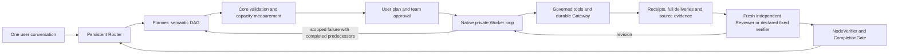

# Phase 2 — Agent Intelligence Report

Current implementation, 2026-11-16: V30 resolves the eight V29 local failures,
adds task-sized delivery/response allowances, two bounded corrections in new
measured plans and executable tool presentation after complete zero-action
prefetch. The latest live L1 reached structured delivery and two independent
reviews; all 15 calls settled with zero unknown usage, but content review still
failed. Full acceptance remains open; L2/L3 and the full suite were not rerun.
See the [current handoff](PHASE2_HANDOFF.md). Earlier entries below are historical.

Current boundary: V24 passed 1,734 tests with one existing warning in 465.71 seconds. All three strict runs failed during planning; 15 settled calls used 87,044 tokens, with no Worker execution. V25 explicit model-selected capacity profiles are under development. Phase 2 remains incomplete. Earlier progress below is retained; see [V24 evidence](audit/phase2/acceptance-independent-v24-boundary.md).

Updated 2026-11-15. V23 implementation and acceptance are in progress. Phase 2 acceptance is pending the
frozen full suite, all strict current-source L1/L2/L3 checks and the fifteen-goal
matrix. Historical runs and local protocol fixtures retain their separate evidence boundaries.

FORGE retains one persistent user conversation. Router alone faces the user;
Planner, Workers and Reviewer execute privately through the native Core. No
Codex, DSH or Claude Code execution backend is used. Desktop release and UI work
are outside this sprint's acceptance target.

The feedback path can request a remaining-DAG proposal. Core preserves completed
contracts, original runs, artifacts, counters and PASS hashes through explicit
lineage. A replacement plan and team still need approval. A proposal or source
handoff never proves successful execution.

## Implemented behavior and evidence limits

| Area | Implemented mechanism | Evidence boundary |
| --- | --- | --- |
| Router and Planner | Typed decisions, source-bound constraints, separate semantic DAG planning, bounded repair and durable rejection diagnostics | V17–V21 frozen suites passed; V22 recorded three local failures and three failed strict levels; V23 acceptance pending |
| Team selection | Capability eligibility, provenance-bearing observations, bounded dynamic roles and approved team contracts | Historical single-model microstudy; multi-model quality remains unproved |
| Resource admission | Actual native request framing, full source/output/review bounds and opt-in Core-measured serial resource allocation | Measurement is policy admission, not predicted usage or task success |
| Serial reserve | One strict success chain, concurrency one, node baselines and one shared contingency with durable once-only markers | Original scenario totals and Gateway caps remain; shared reserve can be exhausted |
| Native Worker | Private model/tool loop, leases, durable checkpoints, bounded self-repair and structured eight-field delivery | V22 L1 performed three real source reads, prematurely archived them and blocked before review; V23 acceptance pending |
| Evidence handoff | Explicitly approved success-path ancestor declaration and complete `worker_read_completed_delivery` source | Approved graph/persisted edges and succeeded path agree; full original live/fixed evidence is revalidated; delivery remains untrusted model claims |
| Independent review | Fresh context from original goal, current criteria, complete artifacts/receipts/handoffs and exact packet hash | Same approved underlying model; no independent model diversity |
| Artifact correction | Same Worker's own approved `file_revise` with latest hash and immutable receipt chain | No general repository editing or predecessor-file mutation |
| Context and memory | Complete bounded source exchange archive/readback, lexical indexes and bounded model semantic source-ID selection | One exploratory cross-language semantic sample is independently interpreted below; no general memory-quality claim |
| Recovery | Durable notice processing, idempotent review/semantic feedback recovery and existing process restart harness | Reopening Store in a fixture does not prove a real mid-execution Core process restart |
| Multimodal | Explicit unsupported/input-needed behavior | Typed image/audio/video ingestion and execution remain unavailable |

The original raw review packet cap is 65,536 bytes. Receipt content, artifacts,
delivery fields and predecessor handoffs are complete; no omitted content or
larger cap is used to create a PASS. A successor must execute its own model,
produce its own result and obtain fresh current verification. Complete validated
predecessor delivery can supply read-only evidence without a fabricated action
receipt or unrelated file read.

The serial policy keeps the original L1/L2/L3 totals of 180,000 / 360,000 /
630,000 tokens. Admission requires baselines, one shared reserve and coordination
to fit those totals. Complete V23 staging exposed a remaining L2/L3 gap; the new
approved-source prefetch policy is being implemented and has not passed frozen
acceptance. See [ADR-011](adr/ADR-011-approved-declared-source-prefetch.md).
Every real model attempt still passes the original durable Gateway. Spent,
allocated, rejected-without-usage and unresolved amounts retain their accounting;
another serial start requires fully settled prior attempts, future baselines and
the current complete review/correction cycle. See [ADR-010](adr/ADR-010-bounded-serial-review-reserve.md).

## Recorded results

V16 is a failed historical boundary. Its full suite had 1,304 passed and five
failed tests, one warning, in 328.69 seconds. All three strict live runs failed
before plan approval: five Planner inbox attempts and ten settled Planner HTTP
calls per run, with `Invalid_graph_proposal`. Raw rejected drafts were not saved,
so those diagnostics do not establish a more specific cause. L1/L2/L3 used
66,428 / 78,872 / 90,794 known tokens, respectively, within their original caps.
No Worker, Reviewer, archive or restart occurred. See
[the immutable V16 boundary](audit/phase2/acceptance-independent-v16-boundary.md)
and [read-only usage audit](audit/phase2/live-usage-v16-audit.md).

V17 final predecessor-delivery tests passed 35 cases in 27.19 seconds, including
three-node ancestor reads without shortcut edges and invalid path rejection; the wider
review/context/capacity/Gateway/lineage group passed 157 in 61.94 seconds. Local
scripted HTTP fixtures exercise native Gateway accounting, full source handoff,
fresh review and two serial nodes across Store reopen, with tampering rejected.
These are offline protocol checks and do not establish real model task quality.
The V17 frozen full suite passed 1,405 cases with one warning in 427.75 seconds.
Its three strict live runs nevertheless all failed before a Planner model call
or Worker execution at `Quest_is_too_large_to_plan`. L1/L2/L3 used 4,233 / 4,366 /
4,844 tokens, with two settled calls per run and no unknown usage. Core's legacy
goal-size guard rejected the Router's source-bound task capsule. All failed
records remain. The 201-file historical source archive was independently
rehashed against its original manifest. See
[the V17 boundary](audit/phase2/acceptance-independent-v17-boundary.md) and
[usage audit](audit/phase2/live-usage-v17-audit.md).

V18 repaired the entry guard and passed 1,413 frozen tests with one warning in
408.37 seconds. Its three strict live runs all failed before plan approval at
`Invalid_graph_proposal`, retaining ten rejection events and five Planner inbox
attempts per run. L1/L2/L3 used 80,013 / 87,717 / 102,389 known tokens across
13 / 12 / 12 settled calls; L1 had two Router calls. No unknown attempt, Worker,
review, archive or restart occurred. The independent read-only audit reconciled
all 270,119 known tokens and retained detailed diagnostic availability. The
203-file historical source archive exactly matches its original manifest. See
[the V18 boundary](audit/phase2/acceptance-independent-v18-boundary.md) and
[usage audit](audit/phase2/live-usage-v18-audit.md).

V19 passed 1,448 frozen tests with one warning in 321.62 seconds. Its three
strict live runs failed before plan approval; all twelve calls settled with
58,229 known tokens and no unknown usage. Each run retained one Planner notice
attempt and two rejection events, with no Worker, review, archive or restart.
Five of the six rejections failed executable-criterion validation. The last
rejection reached source/capacity checks. The production wire allowed arbitrary
criterion strings although Core required exact verifier IDs. V20 replaces that
wire ambiguity with typed verifier kinds and paths, and moves exact source-size
arithmetic into shared Core measurement. Original scenario standards and limits
remain. See [the V19 boundary](audit/phase2/acceptance-independent-v19-boundary.md)
and [usage audit](audit/phase2/live-usage-v19-audit.md).

V20 passed 1,490 frozen tests with one warning in 312.74 seconds. L1 reached an
approved plan but failed during team composition; L2/L3 failed during planning.
All 22 calls settled at 108,458 known tokens, with no Worker or restart. The
[V20 boundary](audit/phase2/acceptance-independent-v20-boundary.md) retains those
failures. A separate [read-only Composer replay](audit/phase2/composer-capacity-v20-readonly.md)
demonstrates the mismatch between approved and model-selected output ceilings;
it does not reconstruct an unsaved rejected response.

V21 passed 1,560 frozen tests with one warning in 445.09 seconds. L1 passed
plan/team approval and performed three successful real file reads. Its Worker
blocked after two rejected deliveries and before independent review. L2/L3
failed planning. All eighteen calls settled at 83,527 tokens; final unknown
usage was zero. The original transient-unsettled failure flag remains, with no
claim that final settlement proves an earlier state. No process restart was
reached. See [the V21 boundary](audit/phase2/acceptance-independent-v21-boundary.md),
[usage audit](audit/phase2/live-usage-v21-audit.md) and
[timing addendum](audit/phase2/live-usage-v21-timing.md).

V22 recorded 1,592 passed and three failed tests, one existing warning, in
352.37 seconds. Its new schema diagnostics lost the existing top-level safe
field path; V23 restores that contract without changing the old assertions.
All three strict runs failed. L1 read three sources, but its input-acquisition
call consumed part of a baseline sized only for synthesis; the next full
request exceeded its allowance by 666 and archived all three source bodies.
Subsequent rereads exceeded the declared complete receipt bound. L2/L3 first
failed criterion validation; their one repair then exposed previously hidden
raw review/native/correction capacity failures. All nineteen attempts settled,
using 83,594 tokens, with no final unknowns. No review or process restart
occurred. See [the V22 boundary](audit/phase2/acceptance-independent-v22-boundary.md)
and [usage audit](audit/phase2/live-usage-v22-audit.md). V23 corrects these
structural gaps within the original task, context, approval and retry limits.

One fixed real semantic-selection call used 1,826 known tokens and settled fully.
Its original probe verdict remains false: the oracle listed four manually seeded
records while source sync added two global literal constraints. Independent
read-only reconstruction matched the complete six-candidate snapshot and all
three returned target-source records, retaining their trust and exact original
message row bytes/hashes. All eleven independent checks passed with zero
database changes. Both seeded Quests remain proposed. See
[the separate interpretation](audit/phase2/semantic-crossquest-v17-independent.md).
This supports only that bounded retrieval sample; it does not establish task
execution, source diversity or general semantic quality.

The historical controlled algorithm study recorded 25 successes and 65 failures
across 90 rows, six cases and fifteen policy variants. Its 135 real calls used
111,243 known tokens. One model, unequal call counts, independently sampled
candidates and deterministic repair feedback limit comparative conclusions.
Preserve every failed row and original score; do not claim broad dynamic-team
superiority. See [the independent historical score audit](audit/phase2/live-algorithm-study-v16-independent.md).

## Final acceptance

The final evidence must bind the exact frozen source, full JUnit/static records,
original test/evidence preservation, published strict live records and read-only
usage audit. All fifteen requested capabilities need explicit evidence and
limitations. A passing local suite, model protocol call, admission measurement
or partial live chain does not satisfy strict complex-task continuity.

Unconfigured monetary cost remains unknown. General task correctness,
multi-model selection quality, autonomous replanning quality and multimodal
execution are not established by the current evidence.
