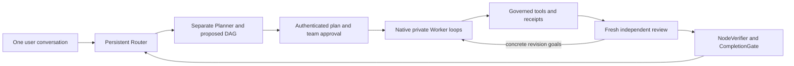

# Phase 2 — Agent Intelligence Report

Updated: 2026-11-15 (Asia/Shanghai). Branch: `codex/phase1-continuous`.
Integration owner: root agent. **Phase 2 is in progress. Strict L1 passes are recorded;
L2/L3 complex-task acceptance remains unmet; v12 frozen backend checks passed.**

## Scope and architectural change

This sprint moves the existing backend toward autonomous task execution. Desktop
visual changes, packaging and the deferred M7 desktop Alpha are outside this sprint's
acceptance. Existing Phase 1 reports and failed experiments remain preserved.

The source audit and complete execution diagram are in the
[execution-chain audit](audit/phase2/execution-chain-audit.md). The minimum change is
recorded in [ADR 009](adr/ADR-009-agent-intelligence-contracts-and-review.md):

All model requests use the existing Gateway and durable admission ledger. The
Router remains the only user-facing Agent. Workers, reviewers and durable events
do not create extra user conversations or use another Agent product as a backend.

## Implemented mechanisms

| Area | Current behavior | Verification boundary |
| --- | --- | --- |
| Router and Planner | Strict decisions, one bounded repair, atomic turn commits, original and latest goal-update request IDs/hashes, offered-tool/capability checks, DAG limit of eight nodes/sixteen edges | Mock reasoning and local persistence regressions; live protocol coverage below |
| Team intelligence | Existing single-model/greedy/coverage/complementarity strategies consume sourced online observations with counts and Wilson intervals; proposals retain profile/source hashes | Synthetic selection proxies and local/Mock integration; no measured general model-quality gain |
| Team adaptation | Approved replacement may cover remaining nodes while retaining completed assignments and historical approvals | Local regression; general autonomous remaining-DAG replanning and hierarchical expansion incomplete |
| Native Worker | Private model/tool loop, checkpoints, fenced lease renewal between settled steps, bounded repair, distinct failure categories and structured delivery | One earlier strict L1 pass with self-repair; v8 failed L1/L2 show actual Worker archives and NEEDS_REVISION, without mid-execution Core restart; v10 L2 shows settled restart/Router archive/readback and architect continuation before later receipt-read block; whole-task continuity pending |
| Artifact revision | Separately approved R1 `file_revise` atomically replaces the same Worker's own latest produced artifact using an intact receipt chain and unchanged hash | Local/Mock race, provenance and immutable-history checks; general repository editing remains absent |
| Independent review | Fresh packet from original goal, criteria, real artifacts and receipts; PASS/NEEDS_REVISION/REJECT/BLOCKED; concrete revision goals, default two-round limit, hard maximum four | Current same approved underlying model in a separate context; independent model diversity is absent |
| Evidence gate | Review provenance plus fixed semantic verifiers and final receipt/artifact/approval checks govern completion | Mock/adversarial regressions and actual local tool checks; self-report never establishes live completion |
| Context and constraints | Bounded Router/Worker highlights, original-source readback, sourced literal/pending/confirmed clauses, potential conflicts, expiry and revocation | 53 combined Router/Planner/context/memory tests; 9 exploratory synthetic source-identity cases |
| Memory | L0 current interaction, L1 Quest, L2 project/history and L3 failure observations; bounded keyword/alias/Quest/time/type filtering | Lexical retrieval; embeddings and learned semantic relevance absent |
| Agent protocol/recovery | Typed projection of existing event transport with task identities, fenced leases and deduplication; unresolved effects retain reservations | Per-type payload validation remains partial; arbitrary in-flight external-effect recovery is unproven |

The delivery vocabulary contains `summary`, `findings`, `decisions`, `artifacts`,
`evidence_references`, `unresolved_issues`, `confidence` and `next_actions`.
`delivery_review` enforces all eight. Legacy/default compatibility schemas still
require only `summary`; missing fields are not evidence of completed work.

For new native TeamWire proposals, only explicit `output_schema_json=null`
selects a deep copy of `STRICT_DELIVERY_OUTPUT_SCHEMA`: the model must supply
all eight delivery fields and confidence within 0–1, with no Core-inserted defaults.
The contract is checked under any node criterion through JSON Schema and bounded
repair. Legacy/default direct RoleSpec contracts and explicit older schemas retain
their original meaning; historical approvals/results are unchanged. Non-finite
JSON values are rejected through the existing bounded repair path. Strict structure
does not establish semantic correctness or replace review/evidence gates.

`file_write` remains create-only. `file_revise` requires explicit plan/node and
team authority plus a workspace grant, with `path`, `prior_receipt_id`,
`expected_sha256` and full replacement `content`. It checks the latest successful
same-Worker receipt, current file bytes and authority immediately before atomic
replacement. Immutable intent parameters and receipts retain every prior version.
Review and read-only acceptance validate the bounded revision chain (at most 64
receipts) before comparing current bytes with the latest successful version.
Predecessor artifacts, user files, stale hashes and unsettled outcomes are excluded;
old create-only contracts acquire no additional authority.

Reviewer output is capped by 8192, the approved role/model caps, remaining model
context and original cumulative Worker tokens. Adaptive capacity keeps a floor of
`min(1024, original output cap)`; inability to fit that floor or original cost
limits fails closed. Native Gateway input reservation uses the actual serialized
payload, including schema/reasoning settings, and matches Core admission.
Review evaluates the current node's objective, criteria and approved role; an
intermediate read-only researcher is not asked to produce a downstream writer's
artifact. Nodes assigned final deliverables retain all original requirements.
`FORGE_REVIEW_MAX_ROUNDS` defaults to two and accepts integers one through four;
the live harness explicitly selects three within its scenario's three-round cap.
Existing runs retain their original review limits and results.
Large packets can use a lossless wire envelope while the original `_packet` and
PASS `packet_sha256` stay unchanged. Full `file_read` source text appears once in
untrusted blocks bound to receipt references, text SHA256 and UTF-8 lengths.
Repeated constraint metadata uses shared fields; a statement already present
verbatim in an original/update message uses that same source's exact Unicode
`[start,end)` span, otherwise its full text remains. Native structured-output
requests retain the Gateway schema while avoiding a duplicate system-prompt copy.
The original L2 fixture packet was 56,755 bytes: its old conservative reserve was
73,065, the review-envelope estimate is 64,622 and actual local
`ProviderGateway._payload` construction reserves 64,245, within the same 65,536
context ceiling. All three source texts remain complete. This construction made
no network call, changed no historical run and establishes admission only for
that exact fixture; larger packets still fail closed when limits are exceeded.
Receipt-bound JSON syntax errors produce concrete line/column and receipt/hash
feedback labelled `deterministic_artifact_validation` / `core_json_parser`, with
`NEEDS_REVISION` only while repair/round/step/token/deadline limits permit, otherwise
`BLOCKED`. This is a Core-parser result, with no fictional model call or PASS.
A truncated model verdict can be retried only after exact admitted/settled usage
is reconciled (or under explicitly labelled Mock tests). `review.response_rejected`
records `reason_code=truncated`; actual usage remains charged, subsequent rounds
consume the same budgets, and unknown remote outcomes are not replayed. A committed
revision verdict can be requeued idempotently after restart.

The fixed numeric verifier has a separate feedback path: a genuine failed
`scheduler-v1` subprocess report can emit `review.result` with
`review_context=deterministic_semantic_validation` and
`validation_source=core_fixed_numeric_suite`. It binds the latest delivery,
Quest/plan/revision/Worker/run, actual semantic run, receipt, source and report
hashes, with at most ten failed-case diagnostics. Requeue calls the same Worker's
revision handler only when graph/node/Worker/member tool scopes explicitly permit
`file_revise`, a current grant exists, repair/step/token/tool/cost/deadline budgets
remain and no action or Gateway attempt is unresolved. A new delivery and genuine
suite PASS are still required; deterministic feedback is no LLM verdict or PASS.
Duplicate result feedback is rejected. Callback errors or fake success fail closed;
a callback that committed before raising has its exact queued revision fenced.
Persisted semantic feedback can recover once after a crash before callback, including
semantic-only nodes, through `IndependentReviewService.tick()` without issuing a
model review. Recovery rechecks `revision_available=true`, actual semantic/source/
receipt and current execution bindings, current tool scopes/grants, tool/cost
headroom and absence of unsettled actions or Gateway attempts. The existing Worker
revision interface still checks the latest delivery, approved team, cumulative
repair/step/token/deadline limits and idempotent consumption. Stale or changed
sources, revoked authority, exhausted budgets and originally unavailable revision
events remain blocked. This does not recover an arbitrary external action.

Valid Worker owners renew between settled steps to the earlier of the task deadline
and `now + lease_seconds`. Renewal preserves token/generation fencing and current
plan/team/status checks; expired claims, competing owners and paused/cancelled or
changed-plan assignments fail closed. Each call still fits the current lease and
deadline. This is not an in-flight heartbeat or a larger task allocation.

Team token allowance and single-request context are separate bounds. A member's
`input_tokens + output_tokens` becomes its cumulative Worker/review allowance;
the allowance may span several context windows. Each request remains bounded by
the approved/current model context, remaining cumulative tokens and the per-response
output limit. Node/team/global approvals, cost ledgers and finite generation caps
remain in force; compaction and review do not refresh the allowance.
The node schema permits at most 1,000,000 cumulative tokens, matching the existing
graph ceiling; summed node allowances still fit the approved graph total. The
lower live scenario caps remain L1 180,000, L2 360,000 and L3 630,000. Existing
approvals are unchanged. See the [budget audit](audit/phase2/cumulative-budget-and-quest-identity.md)
for the distinction between this schema ceiling and an actual approved allocation.

Constraint provenance is separate from execution authority. Literal clauses are
`explicit_user`, model paraphrases are `pending_model`, and a distinct original
user confirmation can produce `user_confirmed`. Original IDs and hashes are checked;
potential conflicts are surfaced rather than silently resolved by recency.

Router archives keep at most 64 user highlights/12,288 UTF-8 bytes and 16 other
highlights/4,096 bytes. Worker highlights are trimmed to their actual input budget;
initial contracts and live tool pairs are protected. Per-Quest evidence and receipt
snapshots each cap at 64 and signal omissions. Original durable records remain
available for checked source readback. These bounds solve repeated full-history
injection, not unlimited context or storage.

A fully settled latest tool exchange may also leave the live message window when
its minimum pinned representation cannot fit, but only after a prior archive makes
the source-read tool available in the current request. The entire call/results
batch is archived together with explicit omitted/raw-readback/untrusted metadata,
same-run successful receipt bindings and original-source integrity. Pending or
uncertain tails and required initial contracts remain protected. The retained L2
failure's offline read-only backup reproduced the block, then fit 12,326 bytes
within the same 21,759-byte input budget with exact source readback and unchanged
budgets/evidence; the original live failure is preserved. [Sprint F](audit/phase2/sprint-f.md)
records the 97-case related regression group and diagnostic limits.

Quest identity recall separately selects actual task/Core Quest records, with at
most 100 returned items/65,536 bytes and the existing 512-candidate scan ceiling.
Omitted ordinary constraint/message facts do not by themselves imply an ambiguous
Quest when identity recall is complete. Multiple Quest IDs, identity result omissions
or a remaining candidate cursor still require clarification without an explicit
user-supplied Quest ID. Filtering after the candidate cap remains conservative.

## Evidence categories

### Local and Mock verification

| Record | Observed result | What it establishes |
| --- | --- | --- |
| [B/F combined JUnit](audit/phase2/sprint-bf-integrated-tests.xml) | 53 passed, 18.36 seconds | Router/Planner repair and contract checks, constraint provenance, bounded compaction/source recovery |
| [Driver JUnit](audit/phase2/driver-tests.xml) | 5 passed, 0.57 seconds | Truthful archive/readback, missing database, budget inspection and integrity failure handling |
| [C/I report](audit/phase2/sprint-ci.md) | 42 passed, 14.61 seconds | Team observation provenance, selection, remaining-node replacement and benchmark contracts |
| [D/E/G report](audit/phase2/sprint-deg.md) / [JUnit](audit/phase2/worker-review-final-tests.xml) | 128 passed, 46.34 seconds | Worker repair, review lifecycle and Gateway claims, Dispatcher, tools, receipt and fixed verifier regressions |
| [Owned-artifact revision / Reviewer repair JUnit](audit/phase2/worker-revision-final-tests.xml) | 153 passed, 40.63 seconds | Same-Worker revision chains, Core-parser feedback, bounded settled-truncation repair and local tool/evidence integration |
| [Worker lease JUnit](audit/phase2/worker-lease-recovery-tests.xml) | 90 passed, 32.30 seconds | Multi-step renewal, task deadlines, stale/competing/paused ownership, Gateway timeout and retained unknown reservations |
| [Review restart JUnit](audit/phase2/worker-review-restart-tests.xml) | 28 passed, 13.95 seconds | Durable revision verdict and idempotent requeue recovery |
| [Fixed-suite semantic revision report](audit/phase2/sprint-ci.md) | 119 passed, 44.14 seconds, including 21 new semantic-revision cases | Actual local numeric subprocess failure, same-Worker governed revision and re-verification, stale/unauthorized/unsettled/callback fail-closed cases; scripted model fixtures, no Provider call |
| [Semantic revision crash-recovery JUnit](audit/phase2/semantic-recovery-20261115T090801.xml) | 74 passed, 34.65 seconds; semantic test file now has 30 cases | Persisted feedback before callback recovers once after reopen, including semantic-only nodes, with current authority/budget/source guards and no model-review request; local/Mock evidence |
| [Lossless review input / round-limit JUnit](audit/phase2/review-context-20261115T091955.xml) | 118 passed, 36.18 seconds, including 15 new review-context cases | Full source/constraint reconstruction, unchanged packet/PASS binding, real local receipt provenance, exact round configuration and exhaustion diagnostics; no Provider network call |
| [Provider/source regressions](audit/phase2/provider-source-regressions.md) / [JUnit](audit/phase2/provider-source-tests.xml) | 42 passed, 4.56 seconds | Environment limits, actual request timeout extensions/deadline, retained unknown reservations and original/latest goal-update integrity |
| [Cumulative budget / Quest identity](audit/phase2/cumulative-budget-and-quest-identity.md) | 40 passed, 3.61 seconds; 67 passed, 32.53 seconds | Separate cumulative/context budgets; unique Quest recovery despite ordinary source omissions; true identity/candidate truncation stays ambiguous |
| [Composer explicit-default contract JUnit](audit/phase2/composer-contract-20261115T093043.xml) | 45 passed, 5.89 seconds, including 21 new cases | Explicit wire null selects the Core delivery schema; incomplete dynamic contracts and role aliases remain rejected; scripted model fixtures |
| [Review scope/output-cap JUnit](audit/phase2/review-scope-cap-tests.xml) / [diagnostic](audit/phase2/review-scope-cap.md) | 123 passed, 31.80 seconds | Current-node review scope, exact native payload accounting and bounded adaptive output; local/Mock evidence |
| [Full-suite v4 diagnostic JUnit](audit/phase2/frozen-tests-v4.xml) | 781 passed, 6 failed, 1 warning, 290.98 seconds | Six M4 Mock Planner fixtures used non-executable Done/Ready criteria; the failed full-suite attempt is preserved |
| [Legacy Planner fixture regression JUnit](audit/phase2/planner-legacy-fixture-regressions.xml) | 21 passed, 12.89 seconds | Only fixture criteria changed to delivery_review, preserving original assertions; later v5 full rerun passed, v12 frozen checks recorded; final complex-task acceptance incomplete |
| [Full-suite v5](audit/phase2/frozen-tests-v5.xml) / [console log](audit/phase2/frozen-tests-v5.log) | 820 passed, 1 warning, 219.96 seconds | Full backend suite before v6 changes; manifest a1f4646c… |
| [Composer operator cap](audit/phase2/composer-concurrency-20261115T094900.xml) | 69 passed, 5.70 seconds | New/replacement proposals and approval; historical contracts unchanged; local/Mock |
| [Worker report guidance](audit/phase2/worker-report-guidance-tests.xml) | 99 passed, 28.05 seconds | Soft guidance, all required content preserved; local/Mock |
| [Full-suite v6](audit/phase2/frozen-tests-v6.xml) / [console log](audit/phase2/frozen-tests-v6.log) | 848 passed, 1 failed, 1 warning, 283.77 seconds | Actual parallel lifespan regression exposed Worker/Gateway concurrency conflation; failed attempt retained, original test unchanged |
| [Full-suite v7](audit/phase2/frozen-tests-v7.xml) / [log](audit/phase2/frozen-tests-v7.log) | 849 passed, 1 warning, 216.87 seconds | Manifest 58339132…/155 files; Ruff and 152-file formatting passed; precedes v8 |
| [Native delivery contract](audit/phase2/native-delivery-contract-20261115T151500.xml) | 185 passed, 47.49 seconds | Explicit-null strict schema, compatibility and runtime repair; local/Mock |
| [Latest delivery/non-finite test file](audit/phase2/native-delivery-nonfinite-20261115T152200.xml) | 36 passed, 5.97 seconds | Overlaps prior group; current bounded non-finite JSON repair, no full/live claim |
| [Reviewer lossless-reference group](audit/phase2/reviewer-lossless-v8-tests.xml) / [diagnostic](audit/phase2/reviewer-lossless-v8-diagnostic.json) | 124 passed, 60.43 seconds | Exact reversible representation saves 524 native input-reservation bytes for one retained fixture; original packet/hash/raw/context limits unchanged; no network call |
| [Full-suite v8](audit/phase2/frozen-tests-v8.xml) / [log](audit/phase2/frozen-tests-v8.log) | 886 passed, 1 warning, 283.46 seconds | Manifest 92bb6067…/156 files; Ruff, 153-file formatting and pip check passed; precedes v9 |
| [Full-suite v9](audit/phase2/frozen-tests-v9.xml) / [log](audit/phase2/frozen-tests-v9.log) | 895 passed, 1 warning, 237.83 seconds | Manifest 9a33b199…/157 files; Ruff, 154-file formatting and pip passed; precedes v10 |
| [Full-suite v10](audit/phase2/frozen-tests-v10.xml) / [log](audit/phase2/frozen-tests-v10.log) | 915 passed, 1 warning, 279.54 seconds | Manifest 814d0dcc…/158 files; Ruff, 149-file formatting, pip/diff passed; precedes v11 |
| [Full-suite v11](audit/phase2/frozen-tests-v11.xml) / [log](audit/phase2/frozen-tests-v11.log) | 941 passed, 1 warning, 199.39 seconds | Manifest eec443f0…/160 files; Ruff, 157-file formatting, pip/diff passed; precedes v12 |
| [Frozen full suite v12](audit/phase2/frozen-tests-v12.xml) / [log](audit/phase2/frozen-tests-v12.log) | 955 passed, 1 warning, 251.43 seconds | Manifest ccc5efe6…/162 files; Ruff, 159-file formatting, pip/diff passed |
| This round's machine-readable consolidation | V12 frozen measured partial state | `docs/audit/phase2/verification.json` records open gates, not Phase 2 completion |

The context work is documented in [Sprint F](audit/phase2/sprint-f.md). The D/E/G
record includes Mock/adversarial review recovery and real governed local tools;
the Provider/source group uses HTTP MockTransport and SQLite. Final integration
must be recorded against the final source snapshot. These tests are not counted
as live model task results.

New driver records and published snapshots include only allowlisted
`runtime_settings`: reasoning effort, review rounds, Worker lease seconds,
Provider timeout seconds, retry limit and effective model token/concurrency limits. Missing legacy values remain null;
later settings do not rewrite historical runs or prove the upstream model's
internal behavior.

### Exploratory synthetic experiments

The [benchmark v8 rerun](audit/phase2/benchmark-final-v8.json), `benchmark_79b287013615`,
completed in 17.598702 seconds with zero Provider calls and the unchanged fixed
dataset hash. It remains a synthetic/local mechanism experiment, with no live
quality/generalization claim; earlier reruns are preserved.

The later fixed-dataset rerun [benchmark v4](audit/phase2/benchmark-final-v4.json),
`benchmark_609a0d95052e`, completed in 6.3642 seconds with zero Provider calls.
It uses the same dataset hash and retains the 48 contract-valid proposals,
12/12 obligations with source recall, 0/11 false allows, 0/4 false denials and
9/9 source-identity retrieval checks. The scoped limitations below still apply.

[Offline benchmark v2](audit/phase2/benchmarks/offline-intelligence-v2.json), run
`benchmark_c51c77ee97c8`, completed in 9.48 seconds with zero Provider calls. It
contains 48 team proposals across six scenarios/eight strategies, six context
scenarios/five strategies, a 15-case governance matrix and nine retrieval cases.
All team proposals met independent hard constraints. Task-centric compaction plus
source recall recovered 12/12 obligations; task-centric alone recovered 6/12.
The governance matrix had no false allows among 11 expected denials and no false
denials among four expected allows. Actual local tools ran under a Mock Worker fixture.

These are small fixed mechanism evaluations. Team specialist proxies are not task
success; context budgets are serialized bytes, not actual model tokens; the summary
baseline is fixed extractive text; governance ablations are counterfactual and do
not authorize unsafe actions. Same-budget live reviewer/governance quality, real
cost, token savings, rework quality and statistical generalization remain unmeasured.
See [experiments](PHASE2_EXPERIMENTS.md) for metrics, commands and dataset identities.

### Real Provider protocol evidence

Run `20261114T233125Z-d07064` retained at
`.local/phase2/provider/20261114T233125Z-d07064/report.json` passed **11/11 small
protocol cases in 26.712 seconds**. FORGE used its Gateway to reach local
workbuddy-api/wb-in through `http://127.0.0.1:8788/v1`, Provider `wb-local`, requested
model `deepseek-v4.1-flash`. The probe covered minimal dialogue, three Router-schema
responses, three tool-call responses, bounded context recall, two concurrent calls
and streaming. Discovery returned 11 IDs including the requested model.

Proxy request success, returned model response and case correctness are distinct.
Upstream identity is `unverified_proxy_reported_identity`. The finite admission
ceiling was 300,000 tokens/concurrency two; the operator context ceiling was 65,536
and probe output ceiling 1,024. Actual service maxima, rate limits and price remain
unknown. This protocol probe does not establish complex-task completion.

The probe's 11 settled Gateway attempts report 5,444 input and 637 output tokens.
These are reported usage, separate from the 300,000-token admission ceiling; no
trusted price is configured, so cost remains unknown.

That historical probe omitted `reasoning_effort` and used the proxy default.
A separate probe, `20261115T005858Z-7ae2c8`, explicitly requested
`reasoning_effort=none` and passed **10/11 cases in 20.210 seconds**; its record is
`.local/phase2/provider/20261115T005858Z-7ae2c8/report.json`. The minimal dialogue's
exact-text check failed, with the response hash retained. Three Router-schema,
three tool-call, bounded recall, two concurrent-call and streaming checks passed.
The failure remains part of that probe's denominator; it does not replace or alter
the earlier 11/11 record. `none` is an operator request setting, not independent
proof of the upstream model's internal reasoning behavior. Both records retain
`unverified_proxy_reported_identity` and neither establishes complex-task success.
The [published explicit-none probe](audit/phase2/provider-probe-reasoning-none.json)
retains the failed case and allowlisted reported usage separately from the
[historical default probe](audit/phase2/provider-probe.json).

Historical M5 numeric/JSON and M6 bounded continuation evidence remain scoped to
their reports. M6's success followed five preserved diagnostic failures; those runs
are not new Phase 2 results.

## Complex live acceptance and unfinished work

L1 source analysis, L2 multi-Agent architecture comparison and L3 scheduler research,
implementation and experimentation have reproducible input descriptors in
`backend/scripts/phase2/acceptance_scenarios.py`. Descriptors contain actual bounded
repository inputs, source hashes and goals, with no seeded plan/team/approval/receipt
or hidden solution. The following retained runs share source snapshot
`c5e1674f38345a24a26aaf37473ebad97ed67f41fe445ef6f14d7a3c375c9134`.

| Run | Strict result | Observed execution |
| --- | --- | --- |
| L1 `20261115T012115Z-L1-2a34ad` | Passed, 103.621 seconds | 19 model calls, 6 tool calls, reported input/output 87,788/10,429 tokens, zero unknown attempts; NEEDS_REVISION then PASS, one review revision and one Worker self-repair |
| L2 `20261115T012115Z-L2-8e64f5` | Failed, 96.416 seconds | 19 model calls, 6 tool calls, reported input/output 92,916/10,436 tokens, zero unknown attempts; Reviewer asked intermediate read-only research for a downstream final artifact, then the revised packet hit the context limit; no restart observed |
| L3 `20261115T012340Z-L3-17c603` | Failed, 447.913 seconds | Valid seven-node plan; five Composer notices and ten settled Composer calls produced no team and no Worker execution |

L1 establishes bounded source analysis with actual review/rework, but had no context
archive or restart. L2's early stop label mentioned unsettled attempts; its final
durable ledger has zero unknown outcomes. No report artifact or restart is claimed.
L3's model responses were not saved, so the exact missing role/contract field cannot
be determined. A separate reproducible source defect treated explicit output-schema
null as missing despite the prompt offering the Core default. The narrow fix binds
only explicit wire null to the fixed Core schema; all other dynamic contract fields
remain model-supplied, with no aliases or authority expansion. The 45-case local
Composer group above does not retroactively repair the failed live run.

The subsequent [review scope/cap diagnostic](audit/phase2/review-scope-cap.md)
preserves the L2 packet and PASS binding. Its raw packet remains 59,601 bytes;
local native construction reserves input 59,761 plus output 5,775 = 65,536 under
the unchanged model ceiling. This is admission construction, with no network call
or live success. The raw-packet 65,536-byte limit and cost checks still apply.

Two later retained runs share code snapshot
`03ebc502773bc4fb67444efe1834000e52256441ad422739e17dc487d8d86f13`.
L2 `20261115T013328Z-L2-fed968` failed in 80.711 seconds: 16 model/six tool calls,
54,597/9,558 input/output tokens, zero unknown attempts. Raw packet/native input
reservation were 68,294/68,550, above 65,536; declared concurrency three also
exceeded scenario cap two. L3 `20261115T013328Z-L3-4e61d3` failed in 151.834
seconds: 21 model/six tool calls, 91,162/22,775 tokens, zero unknown attempts.
Composer eventually produced a legal seven-role/concurrency-two team. Its
15,776-byte research artifact yielded raw/native sizes 67,009/68,224; Worker use
38,989/70,000 left 31,011 insufficient for full review. Neither run reached
`review.started` or a Core restart. No Reviewer verdict or complex success is claimed.

V7 guidance covers new intermediate JSON artifacts and delivery_review handoffs with downstream consumers
toward about 4 KiB (at most 6 KiB) only when all assigned requirements fit. Complete code, final reports
and required detailed schemas remain full even when larger. This is soft writing
guidance: no stored artifact is truncated, no hard report-size gate is added, and
original packet/PASS/source/raw/context/evidence requirements remain unchanged.
Planner guidance recommends about two model contexts of cumulative allocation for
a source-heavy entry node, when the task ceiling permits, and at least ten percent
coordination reserve within the original total. V8 removes the fixed intermediate-output
preference and preserves enough per-call output for complete schema-valid tool
arguments and delivery. Shared source citation IDs avoid repeating full hashes while
preserving exact references.
New/replacement team proposals and approval enforce a trusted operator concurrency
cap; existing approved teams and historical evidence retain their contracts. Core
supplies Composer and WorkerManager the Worker concurrency cap `2`, independently
of the Gateway model-call concurrency cap. Both resource limits remain enforced.
The live harness takes the smaller CLI/scenario total-token and concurrency limits
and records the effective values. V8–v12 full/live outcomes are recorded; this round's final state remains partial; see the v12 evidence record.

The v6 live snapshot
`474d4e11edc773ade91419fc8668ec18b8a365937faa06d8f6e177bf36581c13`
retains three further failures, all with zero final unknown attempts. L1
`20261115T014735Z-L1-b48614` failed in 122.096 seconds, 15 model/four tool calls,
67,356/11,709 input/output tokens: two NEEDS_REVISION verdicts after earlier
self-repair exhausted the original Worker `max_repairs`, blocking further revision.
L2 `20261115T014735Z-L2-cd59cb` failed in 84.678 seconds, 14 model/five tool calls,
48,105/8,295 tokens. Its 14,060-byte read-only delivery was outside v6's JSON-artifact
guidance. Raw/native input were 60,371/60,425; Worker use 18,143/78,000 left 59,857,
568 short even for review input alone. L3 `20261115T014735Z-L3-4ce51e` failed in
165.77 seconds, 27 model/seven tool calls, 123,506/22,569 tokens: the 11,651-byte
artifact produced raw/native sizes 65,637/66,278, while use 57,093/90,000 left 32,907.
L2/L3 reached neither `review.started` nor a restart. These are retained failures;
v7 guidance does not retroactively repair them or reset any budget.

The [v6 full suite](audit/phase2/frozen-tests-v6.xml) / [console log](audit/phase2/frozen-tests-v6.log)
recorded 848 passed, one failed, one warning in 283.77 seconds.
`test_actual_lifespan_schedules_parallel_dag_verifies_and_relays` in
`test_m5_lifespan_execution.py` failed because Core conflated Gateway model-call
concurrency one with Worker concurrency two, incorrectly reducing the team operator
cap to one. V7 restores Worker concurrency two independently of Gateway admission;
the original regression test remains unchanged. V7 full/live results are recorded below; v8 outcomes are recorded below; v9 results are recorded below; V12 frozen checks are recorded; the v12 evidence record consolidates this round's partial state.

The [v7 full suite](audit/phase2/frozen-tests-v7.xml) / [console log](audit/phase2/frozen-tests-v7.log)
passed 849 tests with one warning in 216.87 seconds. The
[155-file manifest](audit/phase2/source-manifest-v7.json) is
`58339132008a97956237ec38c2eb19eb7062f46b4ef2f5f946567ad52be26627`;
Ruff and formatting for 152 Python files passed. This snapshot precedes v8
strict-delivery/scope/repair changes and cannot validate them.

The v7 live snapshot
`dabcf69804a9f43b30ba10902ec6e781cdc27077bf374ac9f51927593b710de1`
retains three failures, all with zero final unknown attempts:
L1 `20261115T015415Z-L1-d9dedd`, 98.792 seconds, 16 model/four tool calls,
57,113/7,877 input/output tokens, exhausted repair after output at the 2,048 cap
truncated. L2 `20261115T015415Z-L2-b0e9f0`, 93.078 seconds, 19 model/six tool calls,
78,714/11,191 tokens, planned only two nodes despite the required three–four
specialist Workers; its 14,141-byte artifact also hit review context limits.
L3 `20261115T015415Z-L3-2732f0`, 99.483 seconds, 24 model/nine tool calls,
127,932/11,268 tokens, actually received independent NEEDS_REVISION, then exhausted
its ten-step limit before revision could finish. None passed strict acceptance;
complex compaction/restart continuity remains unestablished.

V8 removes the intermediate output_tokens=2048 preference: per-call output must
fit complete schema-valid tool arguments and delivery. Worker instructions cover
the current node's approved objective, role and criteria; downstream nodes retain
their own deliverables. Planner guidance uses one node only when the entire task
is simple read-only analysis and preserves explicitly requested specialist/count
requirements. Composer guidance preserves unique role IDs and correct specialties,
and prefers max_steps=16 only when the user's ceiling permits. Native Core configures
a shared self-repair/review-revision maximum of four; existing counters, original
steps/tokens/tools/cost/time and review-round limits still bind every attempt.
Worker concurrency two remains independent of Gateway model-call concurrency.

The [native delivery contract group](audit/phase2/native-delivery-contract-20261115T151500.xml)
passed 185 tests / 47.49 seconds. The latest
[delivery/non-finite test file](audit/phase2/native-delivery-nonfinite-20261115T152200.xml)
passed 36 tests / 5.97 seconds; this is overlapping local/Mock coverage, not a full
suite or live success. V8–v12 full/live outcomes are recorded; this round's final state remains partial; see the v12 evidence record.

The [v8 full suite](audit/phase2/frozen-tests-v8.xml) / [console log](audit/phase2/frozen-tests-v8.log)
passed 886 tests with one warning in 283.46 seconds. Its
[156-file manifest](audit/phase2/source-manifest-v8.json) is
`92bb6067ff7bc1dadfa6aa9b5994089969603b53b3980a9a5601d0a140e6b9e3`;
Ruff, formatting for 153 Python files and pip dependency checks passed.
This snapshot predates v9 generated-plan/batch-budget guidance changes.

The [v8 lossless-reference diagnostic](audit/phase2/reviewer-lossless-v8-diagnostic.json)
reconstructs the unchanged 64,323-byte retained L2 packet, original packet hash and PASS binding.
Numeric source labels remove only representation-added duplicate hash/length fields;
every original receipt field and complete source block remains exactly recoverable.
Native input reservation falls 64,870 → 64,346, saving 524 bytes of reservation for
this fixture; output 1,190 brings total reservation to the unchanged 65,536 ceiling.
The raw packet cap remains 65,536 bytes. The
[124-case regression](audit/phase2/reviewer-lossless-v8-tests.xml) passed in 60.43
seconds. This is an offline construction, zero Provider requests, with no historical
state change or new live verdict; no measured model-token/cost saving follows.

The v8 live runs share code snapshot
`8480f4f9c4f88a28d3d41047e5b1dbf90f424f9cc7892d0302c13758433c40ff`.
L1 `20261115T020604Z-L1-dceb58` failed in 136.466 seconds, 23 model/14 tool calls,
charged input/output 128,890/14,443 tokens. L2 `20261115T020604Z-L2-7f6370` failed
in 99.597 seconds, 25 model/15 tool calls, charged 109,862/9,567 tokens. Each record
retains one unresolved Router-notice attempt at stop; its reservation is respectively
10,555+4,096 and 10,290+4,096, not actual charged usage. Total actual usage and cost
remain unknown. Both Workers received real NEEDS_REVISION, then repeatedly reread
files and hit the original tool budget without revised delivery. L1 has two actual
Worker archives (17/6 source messages); L2 has four (9/6/6/4). These observations
establish Worker archiving, without a completed task or stopped-Core Router
compaction/mid-execution restart. L3 `20261115T020604Z-L3-30acf0` failed in 103.132
seconds, 18 model/six tool calls, 84,067/12,506 tokens, unknown zero. Its approved
research node required a file artifact while allowing only read tools; the actual
file was absent and packet construction failed before Reviewer/context admission.
No successor ran in L2/L3. The
[independent continuity/live audit](audit/phase2/continuity-and-live-diagnosis-v8.md)
does not infer a repeated-read cause from archives or claim a predecessor handoff
failure/success where no successor executed. All three strict acceptances failed.

V9 rejects a generated node with a concrete artifact verifier unless that same
node already permits `file_write`; feedback uses the original bounded Planner
schema-repair path and inserts no tool authority. Worker requests with an effective per-request allowance ≥8192 show remaining
model steps, tool calls and cumulative tokens, and point to integrity-bound archived
source_refs/current artifact receipts. This guides reuse of evidence without
assuming the repeated-read cause is proved. A tool batch exceeding remaining calls
is rejected before any tool executes and may use the existing bounded repair path;
the settled model attempt stays charged. Original tool/step/token/cost/time and
repair/round limits remain unchanged. Publisher adds numeric retry totals/breakdown
and allowlisted review reason/context fields; prompt/reply/log/artifact bodies stay
excluded, and missing historical fields remain unknown/null. V9 full/live
outcomes are recorded below; V12 frozen results are recorded; whole-task complex continuity remains incomplete.

The [v9 full suite](audit/phase2/frozen-tests-v9.xml) / [log](audit/phase2/frozen-tests-v9.log)
passed 895 tests with one warning in 237.83 seconds. Its [157-file manifest](audit/phase2/source-manifest-v9.json)
is `9a33b199404b777428ff0f0e1a1c1da356ad93b23b4395565fc0d211b3d9203a`;
Ruff, formatting for 154 Python files and pip checks passed. This predates v10.
[Offline benchmark v9](audit/phase2/benchmark-final-v9.json), `benchmark_c4387a6e26ac`,
completed in 5.9372256 seconds with zero Provider calls on the same fixed dataset.

The v9 live runs share snapshot
`624f0ac7cb1873163e2e0a5b1849642bb363d553aedab4331096a0286b134db8`.
L2 `20261115T021801Z-L2-b11011` failed in 80.141 seconds: 17 model/six tool
calls, charged input/output 65,607/9,348 tokens, unknown zero.
L3 `20261115T021801Z-L3-290b7f` failed in 97.584 seconds: 18 model/six tool
calls, charged 71,908/14,522 tokens, one unresolved Router-notice reservation
of 9,985+4,096; total actual usage and cost remain unknown.
Actual receipt-bound intermediate artifacts were 15,235/10,788 bytes respectively.
Read-only reconstruction produced raw packets of 68,207/68,967 bytes, exceeding
the unchanged 65,536 cap. Both retained `review_packet_too_large`, zero
`review.started`, the first Worker at `review_pending`, no successor and no restart.

All 39 finished driver records are safely published in
[snapshot-v2](audit/phase2/live-runs/snapshot-v2/index.json), with original run records and
diagnostic-snapshot-v1 preserved. Publication makes no Provider call and does not
promote failed or unaccepted tasks. Historical retry totals can overlap: the old
`worker_runs.repairs` includes review revisions. V10 counts actual self-repair
events separately and marks future records `retry_accounting=disjoint_event_counts_v2`;
[27 focused regressions](audit/phase2/retry-accounting-v10-fixed.xml) pass, while original
run counters remain unchanged. V10 full/live outcomes are recorded below; v12 frozen results are recorded; the v12 evidence record consolidates this round's partial state.
Core capacity feedback is not independent model review or PASS.

V10 adds labelled Core capacity diagnostics (`deterministic_review_capacity` /
`core_review_capacity`), never a model verdict or PASS. Original packet/source/hash
and 65,536 raw/context caps remain. Same-Worker revision requires approved
`file_revise`, current receipts/grants, remaining original repair/step/tool/token/
cost/time/round limits and no unsettled actions/model attempts. Arithmetic floors
only check whether a complete revision plus real independent review might fit;
they do not remove required evidence or prove compression. Inability to fit is BLOCKED.
The [corrected capacity group](audit/phase2/reviewer-capacity-v10-fixed-tests.xml) passed
143 cases (JUnit 45.843 seconds); the [first 143-case attempt](audit/phase2/reviewer-capacity-v10-tests.xml)
retains one failure. These are overlapping local/Mock tests.
The driver waits read-only for settlement for at most 30 seconds before stopping;
it never resends, cancels or settles unknown remote calls itself.
[Settlement regressions](audit/phase2/driver-settlement-v10.xml) passed 27 cases
(JUnit 4.263 seconds). V10 records use disjoint event-count retry accounting;
historical counters and outcomes remain unchanged.

The [v10 full suite](audit/phase2/frozen-tests-v10.xml) / [log](audit/phase2/frozen-tests-v10.log)
passed 915 tests, one warning, in 279.54 seconds. The [158-file manifest](audit/phase2/source-manifest-v10.json)
is `814d0dcc6496f65d01ededad38a1e45a8d0f9848739467f7c36b985f3c318415`;
Ruff, formatting for 149 Python files, pip and diff checks passed. This precedes v11.
[Benchmark v10](audit/phase2/benchmark-final-v10.json), `benchmark_4f7e4f5325ba`,
completed in 7.5434305 seconds with zero Provider calls on the unchanged fixed dataset.
The [read-only preservation audit](audit/phase2/preservation-v10.json) retains 355 byte-identical
Phase 1 evidence files, all 364 original test identities and nine unchanged reports;
349 test ASTs are identical and 15 changed, with listed assertion replacements.
This is preservation evidence, not an equivalence or live-success claim.

All three v10 live runs share runtime snapshot
`f822b94b68dfa6e682f71fc1930d30054aa47bf41dfc27ef75a984e66f432c40`
and failed strict acceptance. Final unknown attempts are zero in all three; cost
remains unknown. L1 `20261115T061513Z-L1-c94230`: 59.801 seconds, 11 model/five
tool calls, charged 32,806/3,291 input/output tokens. It used a plan ID as an
upstream receipt ID and blocked at `context_source_rejected`, before review.
L2 `20261115T061513Z-L2-62b044`: 80.284 seconds, 17 model/nine tool calls,
75,382/6,207 tokens. Actual independent same-model research review returned PASS
and the source Worker succeeded. With work remaining, Core paused at a settled
boundary, stopped, created a Router archive with two source messages and verified
their readback, then restarted in the same workspace with the same Router ID,
completed node, receipt hashes, settled attempts and cumulative Worker counters.
Resume returned 200. The architect had already started one step before the pause;
it continued after restart, then blocked when reading an 11,211-byte direct
predecessor receipt above the original 8192 readback cap. This demonstrates this
bounded continuity segment, while the final task and strict acceptance failed.
L3 `20261115T061513Z-L3-8fdef4`: 120.099 seconds, 25 model/eight tool calls,
134,215/15,831 tokens. Real independent NEEDS_REVISION led to same-Worker revision;
the new raw packet was 70,657 bytes, native input reservation 70,947. Worker use
98,513/160,000 left 61,487, insufficient for the guarded capacity revision plus
review floor, so Core issued `review_capacity_unrepairable` / BLOCKED. No Core
restart occurred. Its early unsettled-call stop label remains in history; the
final read-only wait observed settlement and the final ledger has unknown zero.
Retry totals under disjoint accounting are 0/0/2, with L3 one review revision and
one background-notice retry, zero Worker self-repairs and zero HTTP retries.

[Snapshot-v3](audit/phase2/live-runs/snapshot-v3/index.json) publishes 42 finished driver
records and preserves snapshot-v2/v1 plus original run records. Publication made
no Provider request and does not promote failed tasks. Historically at v10, v11 was in progress:
bounded correction after a rejected local receipt read and byte/availability hints
have [79 focused passing cases](audit/phase2/receipt-read-repair-v11-tests.xml);
Planner operator-budget enforcement is implemented in v11. V10 L3's model-generated
node budgets summed to 920,000 above its 630,000 scenario ceiling, while actual
Gateway admission always retained that hard ceiling.
V11 full/live outcomes are recorded below; final v12 verification and whole-task
complex continuity acceptance remain pending.

V11 bounds repair of a rejected local `worker_read_action_receipt` before any
external effect: the rejected call stays charged, Core records no-effect proof,
and a fresh call must satisfy original predecessor/scope/receipt bounds.
Upstream references expose result byte count/readback availability and guide
approved artifact file reads instead of oversized receipts. No new tools or
authority are granted. The [79-case focused group](audit/phase2/receipt-read-repair-v11-tests.xml)
passed (JUnit 19.062 seconds); [legacy compatibility](audit/phase2/receipt-repair-legacy-v11.xml)
passed 35 (JUnit 9.704 seconds). Generated Planner proposals now receive and
enforce the trusted operator total-token ceiling before persistence; an over-cap
reply uses the original one repair and repeated violations stop without a plan.
Default/manual/historical contracts remain unchanged. [Budget tests](audit/phase2/planner-operator-budget-v11.xml)
passed 16 (JUnit 1.203 seconds); [compatibility tests](audit/phase2/planner-operator-compat-v11.xml)
passed 51 (JUnit 17.397 seconds). These focused groups overlap the full suite.

The [v11 full suite](audit/phase2/frozen-tests-v11.xml) / [log](audit/phase2/frozen-tests-v11.log)
passed 941 tests, one warning, in 199.39 seconds. Its [160-file manifest](audit/phase2/source-manifest-v11.json)
is `eec443f0aad4687e336a8b9ca3629218ebce4417b8096dabb8eaa44845dc7822`;
Ruff, formatting for 157 Python files, pip and diff passed. This predates v12.
[Benchmark v11](audit/phase2/benchmark-final-v11.json), `benchmark_f23819557132`,
completed in 4.3837569 seconds with zero Provider calls on the unchanged fixed dataset.
[Preservation v11](audit/phase2/preservation-v11.json) still records 355 unchanged Phase 1
evidence files and all 364 original test identities, with the previously disclosed
349 unchanged ASTs/15 modified functions; historical evidence is not rewritten.

The v11 live snapshot is
`dc73aec124a2fc9637e568940a4adfa29b407092d6bcad31ffb11c37839ac520`.
L1 `20261115T062445Z-L1-e6498c` passed strict acceptance in 111.975 seconds:
19 model/five tool calls, charged 102,134/12,157 input/output tokens, unknown zero.
Two real independent same-model NEEDS_REVISION verdicts each led to Worker revision,
then PASS and completed Quest. Disjoint retry accounting records two review
revisions, zero self-repairs/HTTP/background-notice retries. No archive or Core
restart occurred in this L1 run; the earlier L1 pass remains historical evidence.

L2 `20261115T062445Z-L2-b7e197` failed strict acceptance in 177.094 seconds:
37 model/16 tool calls, 199,677/25,402 input/output, final unknown zero.
Research and analysis each received real NEEDS_REVISION, revised and passed;
`work/l2-research.json` and `work/l2-report.json` exist and match latest receipts.
The settled mid-execution Core restart retained the Router ID, completed node,
receipts, settled calls and cumulative counters. Its stopped-Core Router archive
contains one original source with verified readback; resume returned 200.
The analysis successor had one step before pause and continued after restart,
then the final read-only review Worker started. After two steps and six tool reads
it blocked at `context_budget`: its first whole-tail archive could not be built
because that request had no predeclared archive-readback tool. The final report's
existence and intermediate PASS verdicts do not establish final task acceptance.
Disjoint retries are two review revisions plus one background notice; zero
self-repair/HTTP retries. Its early unsettled stop label remains, while final
read-only settlement observed unknown zero.

L3 `20261115T062445Z-L3-ba6bb7` failed in 95.121 seconds: 17 model/six tool
calls, 73,147/13,283 input/output, final unknown zero. Core produced deterministic
`review_capacity_unrepairable` / BLOCKED before independent model review.
Raw packet/native input were 66,309/66,394; Worker use 39,752/110,000 left 70,248.
The old capacity precheck incorrectly summed serial reservations to 76,891;
the maximum per-request lower bound was 49,827. This was an overly conservative
precheck, not an actual Gateway cumulative-budget exhaustion. The raw packet was
still oversized and would require actual governed revision and a new complete
independent review. No such success or Core restart occurred. One background
notice retry is recorded, zero self-repair/review-revision/HTTP retries.

[Snapshot-v4](audit/phase2/live-runs/snapshot-v4/index.json) publishes all 45 finished driver
records while preserving v3/v2/v1 and original run records. V12 is correcting the
serial-reservation precheck; [145 focused cases](audit/phase2/reviewer-serial-capacity-v12-tests.xml)
pass (JUnit 74.570 seconds) with actual Gateway admission over offline MockTransport,
not a live Provider result. First whole-tail archiving must already include the
readback tool in that request and its exact reservation; [87 legacy cases](audit/phase2/first-archive-legacy-v12.xml)
pass (JUnit 65.280 seconds). V12 new-path/full/live results are recorded below.
Neither change expands original authority, budgets or context limits.

V12 corrects the serial-capacity precheck to compare the maximum individual
reservation floor with the remaining original allowance; each subsequent complete
request still requires actual Gateway admission and charges settled usage.
This corrects the conservative v11 rejection without increasing any budget.
First whole-tail Worker archiving now declares source readback in that same
request when steps >0 and the effective per-request allowance is at least 8192,
including the tool's full bytes in original admission. It never enables source
omission without recoverability. The [12-case corrected first-archive group](audit/phase2/first-archive-v12-fixed-tests.xml)
passed (JUnit 1.848 seconds); the [initial 12-case attempt](audit/phase2/first-archive-v12-tests.xml)
retains one failure. The earlier 87 legacy/145 serial-capacity groups are overlapping
local/Mock evidence. No first whole-tail fallback or readback was triggered in
these three new live runs, so that new mechanism remains locally verified only.

The [v12 frozen full suite](audit/phase2/frozen-tests-v12.xml) / [log](audit/phase2/frozen-tests-v12.log)
passed 955 tests, one warning, in 251.43 seconds. The [162-file manifest](audit/phase2/source-manifest-v12.json)
is `ccc5efe69b4493dd77093b4a62f6f6851f09c63ca1f2806298f2e59e80d7f8d7`;
Ruff, formatting for 159 Python files, pip and diff checks passed.
[Benchmark v12](audit/phase2/benchmark-final-v12.json), `benchmark_37ee6599ac54`,
completed in 4.6835418 seconds with zero Provider calls on the same fixed synthetic
dataset. [Preservation v12](audit/phase2/preservation-v12.json) retains 355 byte-identical
Phase 1 evidence files and all 364 original test identities, with 349 unchanged
ASTs and the previously disclosed 15 modifications.

All three v12 live runs share runtime snapshot
`de228407cdb822110db71de4c2ffda7a0a2c351ea02284b4a7e60fcd17d369d4`;
final unknown attempts are zero, cost remains unknown.
L1 `20261115T063556Z-L1-1e03cf` passed strict acceptance in 102.934 seconds:
16 model/four tool calls, charged input/output 66,279/8,829 tokens. Real independent
NEEDS_REVISION led to revision then PASS/completed. Disjoint retry total one is
one review revision; self-repair/HTTP/background-notice retries are zero.
No archive or Core restart occurred in L1.

L2 `20261115T063556Z-L2-a3ad74` failed in 109.832 seconds: 23 model/nine tool
calls, 104,306/10,744 input/output. Source-analysis received real independent
delivery-review PASS and succeeded. A settled mid-execution restart preserved
Router identity, workspace, completed node, receipts, settled calls and budget
counters, with one-source Router archive, verified readback and resume 200.
Draft-report already had one step, 18,234 tokens and zero tools before pause;
those counters survived restart, then it continued to five steps/five tools and
produced receipt-bound `work/l2-draft-report.json`. Its Worker use was
52,939/90,000, leaving 37,061. Read-only reconstruction produces the complete
54,421-byte raw review packet: receipts 23,997, artifacts 12,699, delivery 4,038,
constraints 7,998 bytes, plus original contract/source/identity fields.
The original review allowance was insufficient; `review.blocked` retained
`review_contract_or_budget_failed`, with no new model-review call for that draft.
Disjoint retries are zero. The report and restart segment do not establish final
content acceptance or complex-task completion.

L3 `20261115T063556Z-L3-14d6f5` failed in 115.371 seconds: 21 model/eight tool
calls, 105,632/15,238 input/output. Real independent NEEDS_REVISION led to
`file_revise`; the revised artifact/delivery grew. The complete packet was
68,149 bytes and native input reservation 68,412. Worker use 79,762/120,000 left
40,238; the fixed native input floor 48,956 + revision receipt allowance 1,125 +
minimum verdict 1,024 = 51,105 already exceeds that remainder. The corrected
serial guard therefore retained `review_capacity_unrepairable` / Core BLOCKED.
Tools were two directory lists, four source/manifest file reads, one file write
and one file revision; it did not reread its own artifact. Ordinary Worker
archives existed, but first whole-tail/source-readback was not exercised and
no L3 Core restart occurred. Disjoint retry total one is the real review revision;
self-repair/HTTP/background-notice retries are zero.

The [read-only Reviewer-claim diagnostic](audit/phase2/reviewer-claim-diagnostic-v12.json)
checks an incorrect revision goal from this L3 review: `ast.parse(mode="exec")`
accepts the top-level Return node, and the actual bounded interpreter evaluates
`return 0` to result 0 in two steps. Python bytecode compilation rules are not
that interpreter's contract. This diagnostic made zero Provider calls and changes
no run outcome. Fresh-context same-model review can issue incorrect revision goals;
fixed native numeric semantic gates independently verify applicable artifacts.
A review verdict alone does not guarantee domain correctness.

[Snapshot-v5](audit/phase2/live-runs/snapshot-v5/index.json) publishes all 48 finished driver
records; v4/v3/v2/v1 and original failures remain. The backend source is frozen at
v12 for this round; two additional bounded L2/L3 samples on the same source are now
recorded separately below and do not replace failures. Phase 2 remains incomplete:
complex L2/L3 acceptance, general replanning, learned semantic recall, independent
model diversity and other listed limits remain open.
`docs/audit/phase2/verification.json` consolidates this round's measured
partial status; it is an evidence record, not a completion certificate.

The two final bounded repeats used the identical v12 runtime snapshot, original
scenario limits and no source changes. L2 `20261115T064204Z-L2-3f89c4` failed
strict acceptance in 115.488 seconds: 29 model/nine tool calls, charged
154,973/15,583 input/output tokens, unknown zero. Research had two real independent
NEEDS_REVISION verdicts and revisions; Worker use 122,642/150,000 left 27,358.
Its third complete packet was raw/native 67,630/67,645; fixed native floor
58,051 + receipt allowance 1,124 + verdict 1,024 = 60,199 exceeded the remainder.
Core capacity BLOCKED; no restart occurred. Disjoint retry total two is two
review revisions, with zero self-repair/HTTP/background-notice retries.

L3 `20261115T064204Z-L3-1288e8` failed strict acceptance in 111.105 seconds:
21 model/nine tool calls, 104,171/14,090 input/output, unknown zero and zero retries.
Research received real independent PASS/succeeded at five steps/five tools,
49,821/120,000 tokens. This L3 then demonstrated its first actual settled
mid-execution Core restart: one-source Router archive/readback, same Router ID
and workspace, retained completed node/receipts/settled calls/counters, resume 200.
Math had already started at one step, 18,462 tokens and zero tools before pause;
those counters survived restart, and it continued to five steps/four tools,
49,962/90,000 tokens, producing receipt-bound `work/l3-model.json`.
Its remaining allowance was 40,038. Read-only reconstruction verifies a valid
complete raw packet of 40,350 bytes, including receipts 10,983, artifacts 10,821,
delivery 5,148 and constraints 7,552. Actual native payload construction reserves
39,871 input + minimum verdict 1,024 = 40,895, above the remainder.
`_review_reservation` rejects with `Independent review budget exhausted`;
the historical event stays `review_contract_or_budget_failed`. No math-model
review call ran. This is budget admission failure, not a JSON parse failure.
The restart/readback and successor continuation segment is real; the full complex
Quest still did not complete.

[Snapshot-v6](audit/phase2/live-runs/snapshot-v6/index.json) publishes 50 driver records and
retains snapshot-v5/v4/v3/v2/v1 plus every original run. Across this historical set,
nine unresolved attempts are a known lower bound and six earlier records lack
usage statistics; aggregate unknown-attempt count and true total usage/cost remain
unknown. Reported input/output sums cover only available measurements. Latest
v10/v11/v12 per-run unknown-zero observations do not settle older unknown attempts.
The six missing-statistic records are the five early L1 runs at
21:52:36, 21:56:14, 22:00:18, 22:06:34, 22:08:38 UTC on 2026-11-14 and
`20261114T233731Z-L1-c53b2d`.

The next proposed work is a Core preview of the complete evidence packet and
native review reservation before large artifact production/revision, plus a new
explicit artifact/revision budget contract that reserves room for complete review
and bounded rework within the original total. These are recommendations, not
implemented mechanisms or retrospective grants. Preview must retain full immutable
sources, actual receipts, raw/context limits, original approvals and unknown-outcome
guards; lowering evidence requirements or merely increasing budgets is not acceptance.
The v12 backend source and these documents are frozen for this round.
Phase 2's core complex-task goal remains unmet. The machine-readable
`docs/audit/phase2/verification.json` records this round's measured partial state
and open gates; it is not a Phase 2 completion certificate.

The [retained v9 hint regression](audit/phase2/budget-feedback-intermediate-failure-v9.md)
records six legacy context failures after unconditional budget hints; interrupted
larger groups are not counted. Hints now require an effective per-request allowance
of at least 8192. The unchanged legacy file passed 48 cases / 15.81 seconds and
Planner/publication passed 36 / 3.64 seconds; the corrected combined
[66-case JUnit](audit/phase2/worker-budget-feedback-v9-fixed-tests.xml) has no failure.
These overlapping local/Mock groups are separate from the full suite and live runs.

The v4 full-suite attempt failed six legacy M4 fixtures. Their criteria values were
updated to delivery_review with original assertions intact; 21 focused regressions
passed. The subsequent full v5 passed; v12 frozen checks are recorded below; whole-task acceptance remains incomplete. The newer
[source manifest v5](audit/phase2/source-manifest-v5.json) contains 153 files and hash
`a1f4646cb9acc810f3d35e8f9609a99ed553efd1ce4c2b3a0906d98c0333ed93`.
Ruff, format checks for 150 Python files and diff checks passed for that snapshot;
its full pytest passed 820 tests / one warning / 219.96 seconds. That snapshot predates v6 report/budget/concurrency changes; v6 failures are recorded above; v7 results are recorded above; v8 outcomes are recorded below; v9 full/live results are recorded above; V12 frozen checks are recorded; the v12 evidence record consolidates this round's partial state. The final machine-readable
record is `docs/audit/phase2/verification.json`.

One retained L1 diagnostic, `20261114T235101Z-L1-3318e2`, ended after 146.716 seconds
with `composer_did_not_propose_team`: Composer hit the default 30-second Provider
timeout, and two unknown-outcome attempts remained reserved. This is a failed live
attempt. The subsequent fix exposes validated process settings
`FORGE_PROVIDER_TIMEOUT_SECONDS` (default 30, finite range greater than 0 through 600)
and `FORGE_PROVIDER_MAX_RETRIES` (default 1, integers 0–3), aligns the HTTP timeout
with the request, and sizes Planner/Composer leases for their bounded repair stage.
The live harness uses 120 seconds, a 150-second Worker lease and zero additional retries.
`FORGE_WORKER_LEASE_SECONDS` defaults to 60 and accepts finite values greater than
0 through 600. A later rerun remains
subject to its own recorded result; the failed attempt is preserved.

The requested full success condition requires a complex live task to retain its
goal across real failure, autonomous repair, independent revision, compaction and
Core restart with independently verified artifacts. Storage readback or restart at
the approved-plan boundary alone cannot establish that condition. Current component
connectivity, local tests and protocol success therefore do not justify declaring
Phase 2 complete.

Remaining material limits include general remaining-DAG replanning; exhaustive
coordination payload schemas; learned semantic recall; independent reviewer model
selection; sparse online capability evidence; same-budget live algorithm comparisons;
and safe arbitrary in-flight recovery. Default Review mode still requires authenticated
plan/team/replacement approval. Desktop packaging remains deferred.

| Requested capability | Current boundary and remaining gap |
| --- | --- |
| Semantic memory retrieval | Retrieval is lexical with limited bilingual aliases and source/Quest/time/type filters. No embedding or learned semantic retrieval is implemented. Fixed semantic artifact verification is a separate mechanism. |
| General coding and experiment execution | Workers can create files, check Python syntax and run the fixed pure numeric AST subset. `shell_inspect` exposes only `python_version`; arbitrary shell, unrestricted Python programs, arbitrary test runners and a general patch tool are absent. These mechanisms do not establish general autonomous software development. |
| Artifact correction after review | `file_write` remains create-only. Explicitly approved `file_revise` can atomically replace the current Worker's own latest produced artifact with receipt-chain/hash checks and immutable prior versions. It cannot edit user/predecessor files or provide general repository patching; all original criteria and budgets remain in force. |
| Replanning during execution | Router goal updates and new DAG proposals accept only proposed/awaiting-approval Quests. Team replacement retains the current DAG and completed history. Automatic revision of the remaining running DAG is incomplete. |
| Uniform Worker delivery | Review criteria and new explicit-null native TeamWire contracts enforce eight fields; the new strict schema bounds confidence 0–1. Legacy/direct/default and explicitly older schemas remain compatible. The eight-field requirement is not universal across existing contracts. |
| Long autonomous task continuity | Archives, source checks and bounded recovery exist. Final complex live failure/rework/compaction/restart acceptance remains pending; arbitrary in-flight external-effect recovery is unproven. |
