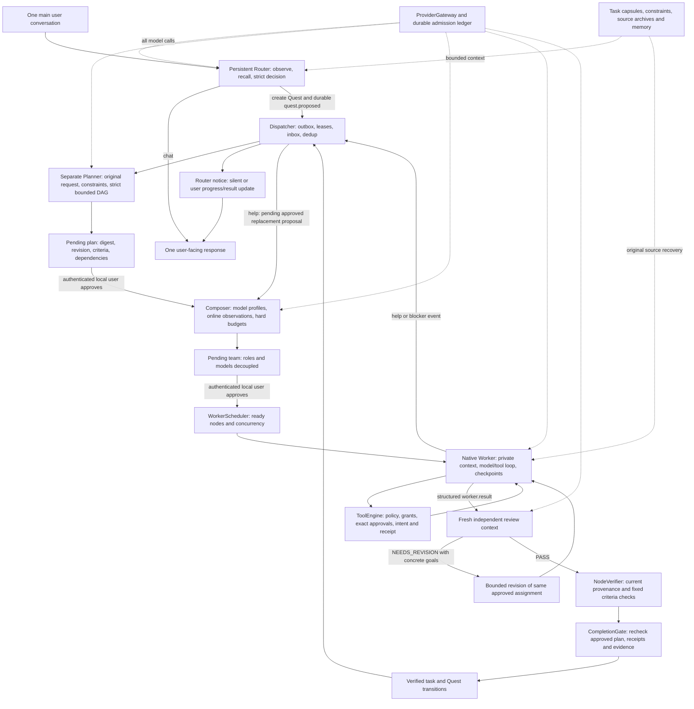

# Phase 2 — Actual Agent Execution Chain Audit

Date: 2026-11-15 (Asia/Shanghai). Branch: `codex/phase1-continuous`.
This is a source/retained-evidence audit of the evolving Phase 2 working tree, not a
frozen acceptance result. Root is the unique integration owner. Phase 1 M1–M7 reports,
the M7 backend-hardening report, required architecture/protocol documents, and the
named Router/Worker/team/graph/dispatcher/context/memory/provider/tool/evidence/
governance modules were read. Earlier audits under `_audit/` describe the pre-change
state; conclusions below include the current Phase 2 changes.

## Executable chain

`forge_api.main._core_lifespan` starts six background loops: Dispatcher, Router notices,
Planner, Composer, WorkerScheduler, and review/verification. Provider latency runs
outside SQLite write transactions. A proposal is not an approved plan, an approved
team, a running Worker or a completed task.

1. `RouterService.handle_user_message` synchronizes memory, observes a bounded snapshot,
   calls the configured Gateway, validates `RouterDecision`, and permits one bounded
   schema-repair request. The final user/assistant messages, Quest, source constraints,
   events and idempotent turn record commit atomically. Chat creates no Quest/Worker.
2. `process_pending_plan` consumes the durable creation event. `QuestGraphService.generate`
   receives the original user-message ID/content with its hash, sourced constraints,
   offered tool catalogue and capability names. Generated plans are limited to eight
   nodes/sixteen edges; invalid names/graphs receive one repair opportunity. `propose`
   persists the DAG; `approve` binds authenticated actor, revision, digest and version.
3. `process_pending_team` proposes bounded role contracts. `TeamComposerEngine.compose`
   filters tool/context/cost/budget incompatibilities and offers single-model, greedy,
   coverage and complementarity search. `performance_snapshot` supplies separate,
   source-digested live/Mock observations with sample counts and Wilson intervals for
   rates; it does not rewrite manually supplied capability scores or infer task success
   from transport success. Team approval binds the plan and selected profile hashes.
4. `WorkerScheduler.tick` launches only approved, ready assignments. `WorkerManager.start`
   checks dependencies, effective tool scope, model identity and token/tool/time/agent/
   depth/concurrency limits. `_run` owns a native checkpointed model/tool loop. `_repair`
   preserves failed diagnostics and bounded repair history; provider, contract, budget,
   dependency, authorization, code and tool failures have distinct classifications.
5. `ToolEngine.prepare/execute` enforces current permissions before action, persists an
   exact intent and records its receipt. R1 writes require a Workspace grant; R2 requires
   exact action approval and operator allowlists; unknown/R3 actions fail closed.
   Separately approved `file_revise` can atomically replace only the same Worker's
   own latest artifact after receipt-chain/hash and current authority checks; immutable
   intents and receipts preserve old content. Existing create-only contracts gain no tool.
   Uncertain external effects are not silently repeated after restart or reassignment.
6. `IndependentReviewService` constructs a fresh packet from the original contract,
   criteria, structured delivery, actual bounded artifacts and trustworthy receipts.
   Judgment covers the current node's objective, criteria and approved role. The
   original request stays complete; nodes assigned final deliverables retain all
   original requirements, while intermediate research retains its read-only scope.
   It does not copy the Worker's private conversation. It currently uses the same
   approved underlying model in a separate context: independent context is not model
   diversity. PASS/NEEDS_REVISION/REJECT/BLOCKED are schema-checked; revision requires
   concrete goals and has a default two-round limit, hard maximum four.
   Large review inputs use a lossless envelope of complete untrusted source blocks,
   exact original-message constraint spans and shared repeated metadata; the original
   `_packet` and PASS hash bindings remain unchanged. Full source text and review
   criteria remain, with unchanged context limits; the [118-case input group](review-context-20261115T091955.xml)
   is local/Mock evidence, with larger over-limit packets still rejected.
   Labelled Core JSON-parser errors can request revision without claiming an LLM review or PASS.
   Settled truncated reviews retain actual charges before a bounded fresh verdict;
   output fits 8192, role/model caps, remaining context and the original cumulative
   token remainder, with adaptive floor `min(1024, original output cap)`. Native
   reservation uses the actual serialized schema/reasoning payload and matches
   Gateway admission; insufficient capacity or original cost authority fails closed.
   Budget/source bindings persist,
   and a committed revision verdict can requeue idempotently after restart.
7. `NodeVerifier` requires the applicable fresh PASS, then performs fixed JSON or numeric
   semantic verification. A genuine failed fixed numeric report may produce labelled
   `deterministic_semantic_validation` feedback for the same Worker's governed revision,
   with exact source/receipt/report/result identities, explicit revision permissions,
   current grant, original budget headroom and no unsettled actions/calls. This is
   neither LLM review nor PASS; the repaired delivery must run the real suite again.
   Persisted feedback before callback can recover once after restart, including
   semantic-only nodes, without a model-review request. Recovery rechecks current
   result/semantic/source/receipt bindings, revision availability, scopes/grants,
   original budgets and absence of unsettled actions/calls; callback errors, stale
   sources and lost authority remain blocked. The [74-case recovery group](semantic-recovery-20261115T090801.xml)
   is local/Mock evidence. `CompletionGate` revalidates approved historical/current
   bindings, original execution mode, actual tool results and artifact hashes before
   completion. Model self-report or Mock evidence alone cannot establish live completion.
8. `Dispatcher` delivers typed event facts at least once with Inbox deduplication and
   fencing. `AgentMessage.from_event` projects task identity and structured coordination
   kinds. Workers cannot directly edit another Worker's task. Only Router appends the
   selected user-facing update to `main`.

## Evidence classification

| Capability | Current implementation | Verification category and limit |
| --- | --- | --- |
| Persistent single Router/conversation, SQLite UoW/CAS, migrations | Real code and durable records | Local restart/transaction tests; Phase 1 M1–M7 retained evidence |
| Strict Router/Planner decisions and bounded repair | Real Gateway-backed production paths | Current B/F 53-test focused suite; reasoning/orchestration assertions are Mock |
| Planner from original request and source constraints | Separate production component | Mock strict-wire, integrity, catalogue and node-limit regressions |
| Dynamic role/model selection and approved replacement | Real bounded composer/scheduler | Offline/synthetic comparisons and Mock integration; no general live superiority claim |
| Model online statistics | Actual bounded Core observations | Provenance/sample counts retained; sparse priors are not measured abilities |
| Native Worker tools/checkpoints | Real runtime and governed local tools | Earlier strict L1 pass includes self-repair; v8 failed L1/L2 show actual Worker archives/NEEDS_REVISION, without Core restart; v10 L2 retains research PASS and settled restart/archive/readback with architect continuation, but whole task remains incomplete |
| Independent fresh-context review and revision | Real production service and evidence binding | Strict L1 live NEEDS_REVISION → PASS; L2 scope/context failure retained; complex continuity incomplete |
| Task capsules, constraints, source readback | Real hash-checked archives and index | 39 context/memory tests; M6 retained narrow live continuation; no infinite-capacity claim |
| Recall | Keyword/source/Quest/time/type filters and bilingual aliases | 9/9 exploratory synthetic source-ID/hash cases; learned semantic/embedding recall absent |
| Agent communication | Durable existing event bus with typed projection | Core identity checks and bounded event flow; exhaustive per-type payload contracts remain partial |
| Full autonomous remaining-DAG replanning | Existing proposal/control/replacement interfaces | General automatic safe replanning and hierarchical expansion remain incomplete |
| Independent Reviewer model selection | Same approved model with fresh context | Separate Reviewer model diversity remains an extension, not implemented evidence |
| Complex multi-domain autonomous completion after failure/rework/restart | Components now connected | Earlier and v11 strict L1 passes without compaction/restart; v10/v11 L2 demonstrate bounded restart/Router archive/readback and successor continuation; v11 L2 still blocks at final Worker context and L3 at an incorrect capacity precheck; whole-task acceptance remains pending |

For new native TeamWire proposals, only explicit `output_schema_json=null`
selects a deep copy of `STRICT_DELIVERY_OUTPUT_SCHEMA`: the model must supply
all eight delivery fields and confidence within 0–1, with no Core-inserted defaults.
The contract is checked under any node criterion through JSON Schema and bounded
repair. Legacy/default direct RoleSpec contracts and explicit older schemas retain
their original meaning; historical approvals/results are unchanged. Non-finite
JSON values are rejected through the existing bounded repair path. Strict structure
does not establish semantic correctness or replace review/evidence gates.

The old narrow output-schema compatibility contract still permits summary-only results;
`delivery_review` explicitly requires all eight delivery fields. Do not state that every
legacy Worker contract enforces all eight fields. Default autonomy remains Review:
model-generated plans, teams and replacements remain pending until authenticated approval.

## Actual live Provider evidence

The new retained probe is
`.local/phase2/provider/20261114T233125Z-d07064/report.json`: **11/11 small protocol cases**,
26.712 seconds, `wb-local`, self-reported `deepseek-v4.1-flash`, Gateway through loopback
`127.0.0.1:8788/v1`. It covers minimal dialogue, three Router-schema responses, three tool
call responses, bounded context recall, two concurrent calls and streaming. Discovery
returned eleven IDs and included the requested model. The 300,000-token admission ceiling
and concurrency two were finite configuration, not consumed tokens or service maxima.

These records distinguish proxy response, returned model response and case correctness.
Upstream identity remains **unverified_proxy_reported_identity**. Actual maximum context,
output, rate limits and cost remain unknown; the 65,536 context and 1,024 probe-output
ceilings are operator bounds. Protocol success is not an autonomous task-completion result.
The historical 11/11 run omitted `reasoning_effort` and used the proxy default.
The separate explicit-`none` run `20261115T005858Z-7ae2c8` passed 10/11 cases in
20.210 seconds, with a failed exact-text minimal dialogue check and retained
response hash; its three Router, three tool-call, recall, two concurrent-call and
streaming checks passed. The original 11/11 result and new failed case are retained
separately. A request parameter does not independently prove upstream internal
reasoning behavior; both runs retain unverified proxy-reported model identity.
The [explicit-none probe summary](provider-probe-reasoning-none.json) publishes only
allowlisted observations, including the failed case and its response hash.
Phase 1 M5 additionally retains a real numeric tool run and one JSON-syntax completion;
M6 retains one narrow continuation success after five preserved diagnostic failures.

Retained Phase 2 runs share source snapshot
`c5e1674f38345a24a26aaf37473ebad97ed67f41fe445ef6f14d7a3c375c9134`:
L1 `20261115T012115Z-L1-2a34ad` passed strict acceptance in 103.621 seconds with
19 model calls, six tool calls, 87,788/10,429 input/output tokens and no unknown
attempts. It includes one review revision and one self-repair, but no archive or
restart. L2 `20261115T012115Z-L2-8e64f5` failed in 96.416 seconds with 19 model calls,
six successful read/list calls and 92,916/10,436 tokens. Its final ledger contains
no unknown attempts; read-only research was asked for a downstream report and the
revised review hit context limits before a second Reviewer call. No final report
or dependent execution occurred. L3 `20261115T012340Z-L3-17c603` failed in 447.913
seconds after a valid seven-node plan, five Composer notices and ten settled
Composer calls; no team or Worker ran. Original model replies are unavailable,
so the exact missing field cannot be attributed. Runtime settings were reasoning
none, review rounds three, 150-second Worker lease, 120-second Provider timeout
and zero HTTP retries; costs are unknown.

Two later retained runs share code snapshot
`03ebc502773bc4fb67444efe1834000e52256441ad422739e17dc487d8d86f13`.
L2 `20261115T013328Z-L2-fed968` failed in 80.711 seconds: 16 model/six tool calls,
54,597/9,558 input/output tokens, zero unknown attempts. Raw packet/native input
reservation were 68,294/68,550, above 65,536; declared concurrency three also
exceeded scenario cap two. L3 `20261115T013328Z-L3-4e61d3` failed in 151.834
seconds: 21 model/six tool calls, 91,162/22,775 tokens, zero unknown attempts.
Composer eventually produced a legal seven-role/concurrency-two team. Its
15,776-byte research artifact yielded raw/native sizes 67,009/68,224; Worker use
38,989/70,000 left 31,011 insufficient for full review. Neither run reached
`review.started` or a Core restart. No Reviewer verdict or complex success is claimed.

V7 guidance covers new intermediate JSON artifacts and delivery_review handoffs with downstream consumers
toward about 4 KiB (at most 6 KiB) only when all assigned requirements fit. Complete code, final reports
and required detailed schemas remain full even when larger. This is soft writing
guidance: no stored artifact is truncated, no hard report-size gate is added, and
original packet/PASS/source/raw/context/evidence requirements remain unchanged.
Planner guidance recommends about two model contexts of cumulative allocation for
a source-heavy entry node, when the task ceiling permits, and at least ten percent
coordination reserve within the original total. V8 removes the fixed intermediate-output
preference and preserves enough per-call output for complete schema-valid tool
arguments and delivery. Shared source citation IDs avoid repeating full hashes while
preserving exact references.
New/replacement team proposals and approval enforce a trusted operator concurrency
cap; existing approved teams and historical evidence retain their contracts. Core
supplies Composer and WorkerManager the Worker concurrency cap `2`, independently
of the Gateway model-call concurrency cap. Both resource limits remain enforced.
The live harness takes the smaller CLI/scenario total-token and concurrency limits
and records the effective values. V8–v12 full/live outcomes are recorded; this round's final state remains partial; see the v12 evidence record.
The [Composer group](composer-concurrency-20261115T094900.xml) passed 69 cases /
5.70 seconds; the [Worker guidance group](worker-report-guidance-tests.xml) passed
99 cases / 28.05 seconds. Both are local/Mock coverage.

The [Composer group](composer-contract-20261115T093043.xml), 45 passed / 5.89 seconds,
allows explicit wire `output_schema_json=null` to select a deep copy of the fixed
Core schema while rejecting incomplete dynamic contracts; no role aliases or
permission expansion follows. This separate reproduced fix does not establish the
exact cause of the retained L3 failure. The [123-case scope/cap group](review-scope-cap-tests.xml)
and [read-only L2 construction](review-scope-cap.md) reserve 59,761 input plus
5,775 output = 65,536 for the unchanged 59,601-byte packet; original packet/PASS
bindings, the 65,536-byte raw packet limit and cumulative budget remain unchanged.
No network call or live success follows from that construction.

[Full-suite v4](frozen-tests-v4.xml) retained 781 passed, six failed and one warning
in 290.98 seconds. Only the six legacy M4 Mock criteria fixtures changed to executable
`delivery_review`; the [21-case original-assertion regression](planner-legacy-fixture-regressions.xml)
passed in 12.89 seconds. The [v5 manifest](source-manifest-v5.json) contains 153 files;
Ruff, 150-file formatting and diff checks passed. [V5 full pytest](frozen-tests-v5.xml)
and [console log](frozen-tests-v5.log) record 820 passed, one warning / 219.96 seconds,
manifest `a1f4646cb9acc810f3d35e8f9609a99ed553efd1ce4c2b3a0906d98c0333ed93`.
V5 predates v6 changes and does not substitute for their final full/live checks.

The v6 live snapshot
`474d4e11edc773ade91419fc8668ec18b8a365937faa06d8f6e177bf36581c13`
retains three further failures, all with zero final unknown attempts. L1
`20261115T014735Z-L1-b48614` failed in 122.096 seconds, 15 model/four tool calls,
67,356/11,709 input/output tokens: two NEEDS_REVISION verdicts after earlier
self-repair exhausted the original Worker `max_repairs`, blocking further revision.
L2 `20261115T014735Z-L2-cd59cb` failed in 84.678 seconds, 14 model/five tool calls,
48,105/8,295 tokens. Its 14,060-byte read-only delivery was outside v6's JSON-artifact
guidance. Raw/native input were 60,371/60,425; Worker use 18,143/78,000 left 59,857,
568 short even for review input alone. L3 `20261115T014735Z-L3-4ce51e` failed in
165.77 seconds, 27 model/seven tool calls, 123,506/22,569 tokens: the 11,651-byte
artifact produced raw/native sizes 65,637/66,278, while use 57,093/90,000 left 32,907.
L2/L3 reached neither `review.started` nor a restart. These are retained failures;
v7 guidance does not retroactively repair them or reset any budget.

The [v6 full suite](frozen-tests-v6.xml) / [console log](frozen-tests-v6.log)
recorded 848 passed, one failed, one warning in 283.77 seconds.
`test_actual_lifespan_schedules_parallel_dag_verifies_and_relays` in
`test_m5_lifespan_execution.py` failed because Core conflated Gateway model-call
concurrency one with Worker concurrency two, incorrectly reducing the team operator
cap to one. V7 restores Worker concurrency two independently of Gateway admission;
the original regression test remains unchanged. V7 full/live results are recorded below; v8 outcomes are recorded below; v9 results are recorded below; V12 frozen checks are recorded; the v12 evidence record consolidates this round's partial state.

The [v7 full suite](frozen-tests-v7.xml) / [console log](frozen-tests-v7.log)
passed 849 tests with one warning in 216.87 seconds. The
[155-file manifest](source-manifest-v7.json) is
`58339132008a97956237ec38c2eb19eb7062f46b4ef2f5f946567ad52be26627`;
Ruff and formatting for 152 Python files passed. This snapshot precedes v8
strict-delivery/scope/repair changes and cannot validate them.

The v7 live snapshot
`dabcf69804a9f43b30ba10902ec6e781cdc27077bf374ac9f51927593b710de1`
retains three failures, all with zero final unknown attempts:
L1 `20261115T015415Z-L1-d9dedd`, 98.792 seconds, 16 model/four tool calls,
57,113/7,877 input/output tokens, exhausted repair after output at the 2,048 cap
truncated. L2 `20261115T015415Z-L2-b0e9f0`, 93.078 seconds, 19 model/six tool calls,
78,714/11,191 tokens, planned only two nodes despite the required three–four
specialist Workers; its 14,141-byte artifact also hit review context limits.
L3 `20261115T015415Z-L3-2732f0`, 99.483 seconds, 24 model/nine tool calls,
127,932/11,268 tokens, actually received independent NEEDS_REVISION, then exhausted
its ten-step limit before revision could finish. None passed strict acceptance;
complex compaction/restart continuity remains unestablished.

V8 removes the intermediate output_tokens=2048 preference: per-call output must
fit complete schema-valid tool arguments and delivery. Worker instructions cover
the current node's approved objective, role and criteria; downstream nodes retain
their own deliverables. Planner guidance uses one node only when the entire task
is simple read-only analysis and preserves explicitly requested specialist/count
requirements. Composer guidance preserves unique role IDs and correct specialties,
and prefers max_steps=16 only when the user's ceiling permits. Native Core configures
a shared self-repair/review-revision maximum of four; existing counters, original
steps/tokens/tools/cost/time and review-round limits still bind every attempt.
Worker concurrency two remains independent of Gateway model-call concurrency.

The [native delivery contract group](native-delivery-contract-20261115T151500.xml)
passed 185 tests / 47.49 seconds. The latest
[delivery/non-finite test file](native-delivery-nonfinite-20261115T152200.xml)
passed 36 tests / 5.97 seconds; this is overlapping local/Mock coverage, not a full
suite or live success. V8–v12 full/live outcomes are recorded; this round's final state remains partial; see the v12 evidence record.

The [v8 full suite](frozen-tests-v8.xml) / [console log](frozen-tests-v8.log)
passed 886 tests with one warning in 283.46 seconds. Its
[156-file manifest](source-manifest-v8.json) is
`92bb6067ff7bc1dadfa6aa9b5994089969603b53b3980a9a5601d0a140e6b9e3`;
Ruff, formatting for 153 Python files and pip dependency checks passed.
This snapshot predates v9 generated-plan/batch-budget guidance changes.

The [v8 lossless-reference diagnostic](reviewer-lossless-v8-diagnostic.json)
reconstructs the unchanged 64,323-byte retained L2 packet, original packet hash and PASS binding.
Numeric source labels remove only representation-added duplicate hash/length fields;
every original receipt field and complete source block remains exactly recoverable.
Native input reservation falls 64,870 → 64,346, saving 524 bytes of reservation for
this fixture; output 1,190 brings total reservation to the unchanged 65,536 ceiling.
The raw packet cap remains 65,536 bytes. The
[124-case regression](reviewer-lossless-v8-tests.xml) passed in 60.43
seconds. This is an offline construction, zero Provider requests, with no historical
state change or new live verdict; no measured model-token/cost saving follows.

The v8 live runs share code snapshot
`8480f4f9c4f88a28d3d41047e5b1dbf90f424f9cc7892d0302c13758433c40ff`.
L1 `20261115T020604Z-L1-dceb58` failed in 136.466 seconds, 23 model/14 tool calls,
charged input/output 128,890/14,443 tokens. L2 `20261115T020604Z-L2-7f6370` failed
in 99.597 seconds, 25 model/15 tool calls, charged 109,862/9,567 tokens. Each record
retains one unresolved Router-notice attempt at stop; its reservation is respectively
10,555+4,096 and 10,290+4,096, not actual charged usage. Total actual usage and cost
remain unknown. Both Workers received real NEEDS_REVISION, then repeatedly reread
files and hit the original tool budget without revised delivery. L1 has two actual
Worker archives (17/6 source messages); L2 has four (9/6/6/4). These observations
establish Worker archiving, without a completed task or stopped-Core Router
compaction/mid-execution restart. L3 `20261115T020604Z-L3-30acf0` failed in 103.132
seconds, 18 model/six tool calls, 84,067/12,506 tokens, unknown zero. Its approved
research node required a file artifact while allowing only read tools; the actual
file was absent and packet construction failed before Reviewer/context admission.
No successor ran in L2/L3. The
[independent continuity/live audit](continuity-and-live-diagnosis-v8.md)
does not infer a repeated-read cause from archives or claim a predecessor handoff
failure/success where no successor executed. All three strict acceptances failed.

V9 rejects a generated node with a concrete artifact verifier unless that same
node already permits `file_write`; feedback uses the original bounded Planner
schema-repair path and inserts no tool authority. Worker requests with an effective per-request allowance ≥8192 show remaining
model steps, tool calls and cumulative tokens, and point to integrity-bound archived
source_refs/current artifact receipts. This guides reuse of evidence without
assuming the repeated-read cause is proved. A tool batch exceeding remaining calls
is rejected before any tool executes and may use the existing bounded repair path;
the settled model attempt stays charged. Original tool/step/token/cost/time and
repair/round limits remain unchanged. Publisher adds numeric retry totals/breakdown
and allowlisted review reason/context fields; prompt/reply/log/artifact bodies stay
excluded, and missing historical fields remain unknown/null. V9 full/live
outcomes are recorded below; V12 frozen results are recorded; whole-task complex continuity remains incomplete.

The [v9 full suite](frozen-tests-v9.xml) / [log](frozen-tests-v9.log)
passed 895 tests with one warning in 237.83 seconds. Its [157-file manifest](source-manifest-v9.json)
is `9a33b199404b777428ff0f0e1a1c1da356ad93b23b4395565fc0d211b3d9203a`;
Ruff, formatting for 154 Python files and pip checks passed. This predates v10.
[Offline benchmark v9](benchmark-final-v9.json), `benchmark_c4387a6e26ac`,
completed in 5.9372256 seconds with zero Provider calls on the same fixed dataset.

The v9 live runs share snapshot
`624f0ac7cb1873163e2e0a5b1849642bb363d553aedab4331096a0286b134db8`.
L2 `20261115T021801Z-L2-b11011` failed in 80.141 seconds: 17 model/six tool
calls, charged input/output 65,607/9,348 tokens, unknown zero.
L3 `20261115T021801Z-L3-290b7f` failed in 97.584 seconds: 18 model/six tool
calls, charged 71,908/14,522 tokens, one unresolved Router-notice reservation
of 9,985+4,096; total actual usage and cost remain unknown.
Actual receipt-bound intermediate artifacts were 15,235/10,788 bytes respectively.
Read-only reconstruction produced raw packets of 68,207/68,967 bytes, exceeding
the unchanged 65,536 cap. Both retained `review_packet_too_large`, zero
`review.started`, the first Worker at `review_pending`, no successor and no restart.

All 39 finished driver records are safely published in
[snapshot-v2](live-runs/snapshot-v2/index.json), with original run records and
diagnostic-snapshot-v1 preserved. Publication makes no Provider call and does not
promote failed or unaccepted tasks. Historical retry totals can overlap: the old
`worker_runs.repairs` includes review revisions. V10 counts actual self-repair
events separately and marks future records `retry_accounting=disjoint_event_counts_v2`;
[27 focused regressions](retry-accounting-v10-fixed.xml) pass, while original
run counters remain unchanged. V10 full/live outcomes are recorded below; v12 frozen results are recorded; the v12 evidence record consolidates this round's partial state.
Core capacity feedback is not independent model review or PASS.

V10 adds labelled Core capacity diagnostics (`deterministic_review_capacity` /
`core_review_capacity`), never a model verdict or PASS. Original packet/source/hash
and 65,536 raw/context caps remain. Same-Worker revision requires approved
`file_revise`, current receipts/grants, remaining original repair/step/tool/token/
cost/time/round limits and no unsettled actions/model attempts. Arithmetic floors
only check whether a complete revision plus real independent review might fit;
they do not remove required evidence or prove compression. Inability to fit is BLOCKED.
The [corrected capacity group](reviewer-capacity-v10-fixed-tests.xml) passed
143 cases (JUnit 45.843 seconds); the [first 143-case attempt](reviewer-capacity-v10-tests.xml)
retains one failure. These are overlapping local/Mock tests.
The driver waits read-only for settlement for at most 30 seconds before stopping;
it never resends, cancels or settles unknown remote calls itself.
[Settlement regressions](driver-settlement-v10.xml) passed 27 cases
(JUnit 4.263 seconds). V10 records use disjoint event-count retry accounting;
historical counters and outcomes remain unchanged.

The [v10 full suite](frozen-tests-v10.xml) / [log](frozen-tests-v10.log)
passed 915 tests, one warning, in 279.54 seconds. The [158-file manifest](source-manifest-v10.json)
is `814d0dcc6496f65d01ededad38a1e45a8d0f9848739467f7c36b985f3c318415`;
Ruff, formatting for 149 Python files, pip and diff checks passed. This precedes v11.
[Benchmark v10](benchmark-final-v10.json), `benchmark_4f7e4f5325ba`,
completed in 7.5434305 seconds with zero Provider calls on the unchanged fixed dataset.
The [read-only preservation audit](preservation-v10.json) retains 355 byte-identical
Phase 1 evidence files, all 364 original test identities and nine unchanged reports;
349 test ASTs are identical and 15 changed, with listed assertion replacements.
This is preservation evidence, not an equivalence or live-success claim.

All three v10 live runs share runtime snapshot
`f822b94b68dfa6e682f71fc1930d30054aa47bf41dfc27ef75a984e66f432c40`
and failed strict acceptance. Final unknown attempts are zero in all three; cost
remains unknown. L1 `20261115T061513Z-L1-c94230`: 59.801 seconds, 11 model/five
tool calls, charged 32,806/3,291 input/output tokens. It used a plan ID as an
upstream receipt ID and blocked at `context_source_rejected`, before review.
L2 `20261115T061513Z-L2-62b044`: 80.284 seconds, 17 model/nine tool calls,
75,382/6,207 tokens. Actual independent same-model research review returned PASS
and the source Worker succeeded. With work remaining, Core paused at a settled
boundary, stopped, created a Router archive with two source messages and verified
their readback, then restarted in the same workspace with the same Router ID,
completed node, receipt hashes, settled attempts and cumulative Worker counters.
Resume returned 200. The architect had already started one step before the pause;
it continued after restart, then blocked when reading an 11,211-byte direct
predecessor receipt above the original 8192 readback cap. This demonstrates this
bounded continuity segment, while the final task and strict acceptance failed.
L3 `20261115T061513Z-L3-8fdef4`: 120.099 seconds, 25 model/eight tool calls,
134,215/15,831 tokens. Real independent NEEDS_REVISION led to same-Worker revision;
the new raw packet was 70,657 bytes, native input reservation 70,947. Worker use
98,513/160,000 left 61,487, insufficient for the guarded capacity revision plus
review floor, so Core issued `review_capacity_unrepairable` / BLOCKED. No Core
restart occurred. Its early unsettled-call stop label remains in history; the
final read-only wait observed settlement and the final ledger has unknown zero.
Retry totals under disjoint accounting are 0/0/2, with L3 one review revision and
one background-notice retry, zero Worker self-repairs and zero HTTP retries.

[Snapshot-v3](live-runs/snapshot-v3/index.json) publishes 42 finished driver
records and preserves snapshot-v2/v1 plus original run records. Publication made
no Provider request and does not promote failed tasks. Historically at v10, v11 was in progress:
bounded correction after a rejected local receipt read and byte/availability hints
have [79 focused passing cases](receipt-read-repair-v11-tests.xml);
Planner operator-budget enforcement is implemented in v11. V10 L3's model-generated
node budgets summed to 920,000 above its 630,000 scenario ceiling, while actual
Gateway admission always retained that hard ceiling.
V11 full/live outcomes are recorded below; final v12 verification and whole-task
complex continuity acceptance remain pending.

V11 bounds repair of a rejected local `worker_read_action_receipt` before any
external effect: the rejected call stays charged, Core records no-effect proof,
and a fresh call must satisfy original predecessor/scope/receipt bounds.
Upstream references expose result byte count/readback availability and guide
approved artifact file reads instead of oversized receipts. No new tools or
authority are granted. The [79-case focused group](receipt-read-repair-v11-tests.xml)
passed (JUnit 19.062 seconds); [legacy compatibility](receipt-repair-legacy-v11.xml)
passed 35 (JUnit 9.704 seconds). Generated Planner proposals now receive and
enforce the trusted operator total-token ceiling before persistence; an over-cap
reply uses the original one repair and repeated violations stop without a plan.
Default/manual/historical contracts remain unchanged. [Budget tests](planner-operator-budget-v11.xml)
passed 16 (JUnit 1.203 seconds); [compatibility tests](planner-operator-compat-v11.xml)
passed 51 (JUnit 17.397 seconds). These focused groups overlap the full suite.

The [v11 full suite](frozen-tests-v11.xml) / [log](frozen-tests-v11.log)
passed 941 tests, one warning, in 199.39 seconds. Its [160-file manifest](source-manifest-v11.json)
is `eec443f0aad4687e336a8b9ca3629218ebce4417b8096dabb8eaa44845dc7822`;
Ruff, formatting for 157 Python files, pip and diff passed. This predates v12.
[Benchmark v11](benchmark-final-v11.json), `benchmark_f23819557132`,
completed in 4.3837569 seconds with zero Provider calls on the unchanged fixed dataset.
[Preservation v11](preservation-v11.json) still records 355 unchanged Phase 1
evidence files and all 364 original test identities, with the previously disclosed
349 unchanged ASTs/15 modified functions; historical evidence is not rewritten.

The v11 live snapshot is
`dc73aec124a2fc9637e568940a4adfa29b407092d6bcad31ffb11c37839ac520`.
L1 `20261115T062445Z-L1-e6498c` passed strict acceptance in 111.975 seconds:
19 model/five tool calls, charged 102,134/12,157 input/output tokens, unknown zero.
Two real independent same-model NEEDS_REVISION verdicts each led to Worker revision,
then PASS and completed Quest. Disjoint retry accounting records two review
revisions, zero self-repairs/HTTP/background-notice retries. No archive or Core
restart occurred in this L1 run; the earlier L1 pass remains historical evidence.

L2 `20261115T062445Z-L2-b7e197` failed strict acceptance in 177.094 seconds:
37 model/16 tool calls, 199,677/25,402 input/output, final unknown zero.
Research and analysis each received real NEEDS_REVISION, revised and passed;
`work/l2-research.json` and `work/l2-report.json` exist and match latest receipts.
The settled mid-execution Core restart retained the Router ID, completed node,
receipts, settled calls and cumulative counters. Its stopped-Core Router archive
contains one original source with verified readback; resume returned 200.
The analysis successor had one step before pause and continued after restart,
then the final read-only review Worker started. After two steps and six tool reads
it blocked at `context_budget`: its first whole-tail archive could not be built
because that request had no predeclared archive-readback tool. The final report's
existence and intermediate PASS verdicts do not establish final task acceptance.
Disjoint retries are two review revisions plus one background notice; zero
self-repair/HTTP retries. Its early unsettled stop label remains, while final
read-only settlement observed unknown zero.

L3 `20261115T062445Z-L3-ba6bb7` failed in 95.121 seconds: 17 model/six tool
calls, 73,147/13,283 input/output, final unknown zero. Core produced deterministic
`review_capacity_unrepairable` / BLOCKED before independent model review.
Raw packet/native input were 66,309/66,394; Worker use 39,752/110,000 left 70,248.
The old capacity precheck incorrectly summed serial reservations to 76,891;
the maximum per-request lower bound was 49,827. This was an overly conservative
precheck, not an actual Gateway cumulative-budget exhaustion. The raw packet was
still oversized and would require actual governed revision and a new complete
independent review. No such success or Core restart occurred. One background
notice retry is recorded, zero self-repair/review-revision/HTTP retries.

[Snapshot-v4](live-runs/snapshot-v4/index.json) publishes all 45 finished driver
records while preserving v3/v2/v1 and original run records. V12 is correcting the
serial-reservation precheck; [145 focused cases](reviewer-serial-capacity-v12-tests.xml)
pass (JUnit 74.570 seconds) with actual Gateway admission over offline MockTransport,
not a live Provider result. First whole-tail archiving must already include the
readback tool in that request and its exact reservation; [87 legacy cases](first-archive-legacy-v12.xml)
pass (JUnit 65.280 seconds). V12 new-path/full/live results are recorded below.
Neither change expands original authority, budgets or context limits.

V12 corrects the serial-capacity precheck to compare the maximum individual
reservation floor with the remaining original allowance; each subsequent complete
request still requires actual Gateway admission and charges settled usage.
This corrects the conservative v11 rejection without increasing any budget.
First whole-tail Worker archiving now declares source readback in that same
request when steps >0 and the effective per-request allowance is at least 8192,
including the tool's full bytes in original admission. It never enables source
omission without recoverability. The [12-case corrected first-archive group](first-archive-v12-fixed-tests.xml)
passed (JUnit 1.848 seconds); the [initial 12-case attempt](first-archive-v12-tests.xml)
retains one failure. The earlier 87 legacy/145 serial-capacity groups are overlapping
local/Mock evidence. No first whole-tail fallback or readback was triggered in
these three new live runs, so that new mechanism remains locally verified only.

The [v12 frozen full suite](frozen-tests-v12.xml) / [log](frozen-tests-v12.log)
passed 955 tests, one warning, in 251.43 seconds. The [162-file manifest](source-manifest-v12.json)
is `ccc5efe69b4493dd77093b4a62f6f6851f09c63ca1f2806298f2e59e80d7f8d7`;
Ruff, formatting for 159 Python files, pip and diff checks passed.
[Benchmark v12](benchmark-final-v12.json), `benchmark_37ee6599ac54`,
completed in 4.6835418 seconds with zero Provider calls on the same fixed synthetic
dataset. [Preservation v12](preservation-v12.json) retains 355 byte-identical
Phase 1 evidence files and all 364 original test identities, with 349 unchanged
ASTs and the previously disclosed 15 modifications.

All three v12 live runs share runtime snapshot
`de228407cdb822110db71de4c2ffda7a0a2c351ea02284b4a7e60fcd17d369d4`;
final unknown attempts are zero, cost remains unknown.
L1 `20261115T063556Z-L1-1e03cf` passed strict acceptance in 102.934 seconds:
16 model/four tool calls, charged input/output 66,279/8,829 tokens. Real independent
NEEDS_REVISION led to revision then PASS/completed. Disjoint retry total one is
one review revision; self-repair/HTTP/background-notice retries are zero.
No archive or Core restart occurred in L1.

L2 `20261115T063556Z-L2-a3ad74` failed in 109.832 seconds: 23 model/nine tool
calls, 104,306/10,744 input/output. Source-analysis received real independent
delivery-review PASS and succeeded. A settled mid-execution restart preserved
Router identity, workspace, completed node, receipts, settled calls and budget
counters, with one-source Router archive, verified readback and resume 200.
Draft-report already had one step, 18,234 tokens and zero tools before pause;
those counters survived restart, then it continued to five steps/five tools and
produced receipt-bound `work/l2-draft-report.json`. Its Worker use was
52,939/90,000, leaving 37,061. Read-only reconstruction produces the complete
54,421-byte raw review packet: receipts 23,997, artifacts 12,699, delivery 4,038,
constraints 7,998 bytes, plus original contract/source/identity fields.
The original review allowance was insufficient; `review.blocked` retained
`review_contract_or_budget_failed`, with no new model-review call for that draft.
Disjoint retries are zero. The report and restart segment do not establish final
content acceptance or complex-task completion.

L3 `20261115T063556Z-L3-14d6f5` failed in 115.371 seconds: 21 model/eight tool
calls, 105,632/15,238 input/output. Real independent NEEDS_REVISION led to
`file_revise`; the revised artifact/delivery grew. The complete packet was
68,149 bytes and native input reservation 68,412. Worker use 79,762/120,000 left
40,238; the fixed native input floor 48,956 + revision receipt allowance 1,125 +
minimum verdict 1,024 = 51,105 already exceeds that remainder. The corrected
serial guard therefore retained `review_capacity_unrepairable` / Core BLOCKED.
Tools were two directory lists, four source/manifest file reads, one file write
and one file revision; it did not reread its own artifact. Ordinary Worker
archives existed, but first whole-tail/source-readback was not exercised and
no L3 Core restart occurred. Disjoint retry total one is the real review revision;
self-repair/HTTP/background-notice retries are zero.

The [read-only Reviewer-claim diagnostic](reviewer-claim-diagnostic-v12.json)
checks an incorrect revision goal from this L3 review: `ast.parse(mode="exec")`
accepts the top-level Return node, and the actual bounded interpreter evaluates
`return 0` to result 0 in two steps. Python bytecode compilation rules are not
that interpreter's contract. This diagnostic made zero Provider calls and changes
no run outcome. Fresh-context same-model review can issue incorrect revision goals;
fixed native numeric semantic gates independently verify applicable artifacts.
A review verdict alone does not guarantee domain correctness.

[Snapshot-v5](live-runs/snapshot-v5/index.json) publishes all 48 finished driver
records; v4/v3/v2/v1 and original failures remain. The backend source is frozen at
v12 for this round; two additional bounded L2/L3 samples on the same source are now
recorded separately below and do not replace failures. Phase 2 remains incomplete:
complex L2/L3 acceptance, general replanning, learned semantic recall, independent
model diversity and other listed limits remain open.
`docs/audit/phase2/verification.json` consolidates this round's measured
partial status; it is an evidence record, not a completion certificate.

The two final bounded repeats used the identical v12 runtime snapshot, original
scenario limits and no source changes. L2 `20261115T064204Z-L2-3f89c4` failed
strict acceptance in 115.488 seconds: 29 model/nine tool calls, charged
154,973/15,583 input/output tokens, unknown zero. Research had two real independent
NEEDS_REVISION verdicts and revisions; Worker use 122,642/150,000 left 27,358.
Its third complete packet was raw/native 67,630/67,645; fixed native floor
58,051 + receipt allowance 1,124 + verdict 1,024 = 60,199 exceeded the remainder.
Core capacity BLOCKED; no restart occurred. Disjoint retry total two is two
review revisions, with zero self-repair/HTTP/background-notice retries.

L3 `20261115T064204Z-L3-1288e8` failed strict acceptance in 111.105 seconds:
21 model/nine tool calls, 104,171/14,090 input/output, unknown zero and zero retries.
Research received real independent PASS/succeeded at five steps/five tools,
49,821/120,000 tokens. This L3 then demonstrated its first actual settled
mid-execution Core restart: one-source Router archive/readback, same Router ID
and workspace, retained completed node/receipts/settled calls/counters, resume 200.
Math had already started at one step, 18,462 tokens and zero tools before pause;
those counters survived restart, and it continued to five steps/four tools,
49,962/90,000 tokens, producing receipt-bound `work/l3-model.json`.
Its remaining allowance was 40,038. Read-only reconstruction verifies a valid
complete raw packet of 40,350 bytes, including receipts 10,983, artifacts 10,821,
delivery 5,148 and constraints 7,552. Actual native payload construction reserves
39,871 input + minimum verdict 1,024 = 40,895, above the remainder.
`_review_reservation` rejects with `Independent review budget exhausted`;
the historical event stays `review_contract_or_budget_failed`. No math-model
review call ran. This is budget admission failure, not a JSON parse failure.
The restart/readback and successor continuation segment is real; the full complex
Quest still did not complete.

[Snapshot-v6](live-runs/snapshot-v6/index.json) publishes 50 driver records and
retains snapshot-v5/v4/v3/v2/v1 plus every original run. Across this historical set,
nine unresolved attempts are a known lower bound and six earlier records lack
usage statistics; aggregate unknown-attempt count and true total usage/cost remain
unknown. Reported input/output sums cover only available measurements. Latest
v10/v11/v12 per-run unknown-zero observations do not settle older unknown attempts.
The six missing-statistic records are the five early L1 runs at
21:52:36, 21:56:14, 22:00:18, 22:06:34, 22:08:38 UTC on 2026-11-14 and
`20261114T233731Z-L1-c53b2d`.

The next proposed work is a Core preview of the complete evidence packet and
native review reservation before large artifact production/revision, plus a new
explicit artifact/revision budget contract that reserves room for complete review
and bounded rework within the original total. These are recommendations, not
implemented mechanisms or retrospective grants. Preview must retain full immutable
sources, actual receipts, raw/context limits, original approvals and unknown-outcome
guards; lowering evidence requirements or merely increasing budgets is not acceptance.
The v12 backend source and these documents are frozen for this round.
Phase 2's core complex-task goal remains unmet. The machine-readable
`docs/audit/phase2/verification.json` records this round's measured partial state
and open gates; it is not a Phase 2 completion certificate.

The [retained v9 hint regression](budget-feedback-intermediate-failure-v9.md)
records six legacy context failures after unconditional budget hints; interrupted
larger groups are not counted. Hints now require an effective per-request allowance
of at least 8192. The unchanged legacy file passed 48 cases / 15.81 seconds and
Planner/publication passed 36 / 3.64 seconds; the corrected combined
[66-case JUnit](worker-budget-feedback-v9-fixed-tests.xml) has no failure.
These overlapping local/Mock groups are separate from the full suite and live runs.

The [v8 benchmark](benchmark-final-v8.json) completed in 17.598702 seconds with
zero Provider calls on the unchanged fixed dataset; earlier limitations remain.

## Continuity and open boundaries

`ConstraintService` separates literal user clauses, pending model extracts and separately
confirmed records, with original IDs/hashes, potential conflicts, expiry and revocation.
Router/Worker highlights are bounded; omitted originals remain in archives and can be
re-read with source checks. L0 recent interaction, L1 Quest, L2 project/history and L3
failure-experience paths exist. Active Quest counts, indexing batches, candidate pages,
artifact/receipt snapshots and model windows remain finite; learned semantic retrieval,
general source relevance and arbitrary-scale continuity are not established.

Recovery uses durable Worker/model/tool state and lease generations. Unknown remote
outcomes retain reservations until trusted recovery conditions permit action. The current
Worker renews only between settled steps while its token/generation, approved contract
and running Quest remain valid, capped by the task deadline. Expired/stale ownership
cannot be revived and no individual call exceeds its current lease/deadline. The live
driver supports storage compaction/readback, a plan-boundary restart and a restart after
partial node completion. Actual observed snapshots and successful continuation remain
required; a supported option or plan-boundary restart alone does not prove recovery
from an arbitrary in-flight external action.
The independent driver's five offline tests verify missing DB handling, actual budget
inspection, genuine archive/readback, no-op truthfulness and visible integrity failure.
Desktop packaging/UI acceptance is deferred; no new desktop-release claim follows.
New driver snapshots and the Publisher retain only whitelisted runtime settings:
reasoning effort, review-round limit, Worker lease seconds, Provider timeout seconds,
retry limit and effective model token/concurrency limits. Missing legacy fields remain null and do not inherit later configuration.

The fixed tool contracts do not provide arbitrary shell, unrestricted Python,
arbitrary test commands or a general patch operation. `python_compile` proves
syntax only, `numeric_ast` executes a bounded pure numeric subset and
`shell_inspect` permits only `python_version`. `file_write` creates files with
exclusive-create semantics. Explicitly approved `file_revise` only replaces the
same Worker's own latest proven artifact, preserving immutable prior versions;
user files, predecessor artifacts, stale hashes and uncertain outcomes remain
excluded. Review and acceptance compare current bytes with the verified latest
receipt chain rather than treating a legitimate historical hash as current.
Team replacement keeps the approved DAG; Router goal updates
and new DAG proposals remain limited to proposed/awaiting-approval Quests, so
general running-DAG replanning is still absent. Source retrieval remains lexical.
