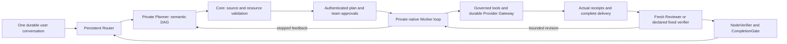

# Phase 2 — Actual Agent Execution Chain Audit

Updated 2026-11-15. Root is the integration owner. V23 implementation is under
verification; no current-source strict completion is claimed. The complete
prior audit is retained in [the documentation checkpoint](checkpoint-pre-v19-docs/index.json).

| Stage | Concrete source path | Evidence boundary |
| --- | --- | --- |
| User intent and lifecycle | `router.py`, `router_domain.py`, `constraints.py` | One main conversation; typed decisions and original message/hash provenance |
| Semantic planning | `quest_graph.py`, `graph_domain.py`, `planner_diagnostics.py` | Production V19 protocol separates semantic output from Core resource numbers; invalid graphs remain rejected |
| Team formation | `team_composition.py`, `registry.py`, `model_performance.py` | Capability/source/observed reliability, exact task bindings and normal approval; one real model limits comparative claims |
| Native execution | `worker_runtime.py`, `worker_prompts.py`, `worker_recovery.py` | Actual model/tool loop, fenced leases, complete structured delivery and finite steps/repairs/budget |
| Tools and artifact revision | `tool_engine.py`, `code_test_harness.py`, `artifact_revision.py` | Approved tool scopes, immutable receipts, bounded pure-function subprocess testing and same-run revision |
| Collaboration | `agent_protocol.py`, `predecessor_delivery.py`, `plan_lineage.py` | Typed durable identities and explicitly approved succeeded ancestor delivery; full source evidence revalidated |
| Review and completion | `independent_review.py`, `review_envelope.py`, `evidence.py` | Fresh same-model context; original full sources, exact current PASS and actual artifacts/fixed checks |
| Context and memory | `context_service.py`, `memory.py`, `semantic_memory.py` | Bounded archives, exact original readback and source-ID semantic selection; no trust promotion |
| Resource and restart continuity | `model_call_budget.py`, `budget_policy.py`, `worker_model_usage.py` | Durable scope caps, unresolved reservations and exact known-usage reconciliation; no budget reset on restart |

Shared serial capacity is limited to an approved success chain with concurrency
one. The initial baselines and one contingency remain within the original task
cap; later starts protect future baselines and require settled prior attempts.
Each successor still needs its own execution and current review. Full delivery
readback creates no fabricated action receipt. See [ADR-010](../../adr/ADR-010-bounded-serial-review-reserve.md).

The latest completed frozen V21 suite passed 1,560 tests with one existing
warning in 445.09 seconds. Its three real task runs failed: L1 obtained plan
and team approval and three real source reads, then blocked before review;
L2/L3 failed planning. Eighteen calls settled at 83,527 known tokens, with zero
final unknown usage. No restart occurred; the original timing failure flag stays.
They establish neither task completion nor process-restart continuity. See
[the immutable boundary](acceptance-independent-v21-boundary.md) and
[read-only usage audit](live-usage-v21-audit.md). V22 full-suite and strict results
remain pending.

Local scripted HTTP fixtures exercise the production adapter and ledger without
a real model. Their native execution_mode field is a transport fact, not real
model quality evidence. The fixed real microstudy scored 25/90 task successes;
the original semantic-probe false result and independent source interpretation
are separately retained. [Experiments](../../PHASE2_EXPERIMENTS.md) records these
categories and all historical failures.

The code does not use Codex, DSH or Claude Code as an execution backend. Desktop
work is separate. Arbitrary shell/repository execution and image/audio/video
execution remain unavailable; prices and upstream model identity are not
independently established. Evidence gates do not prove arbitrary-task correctness.
